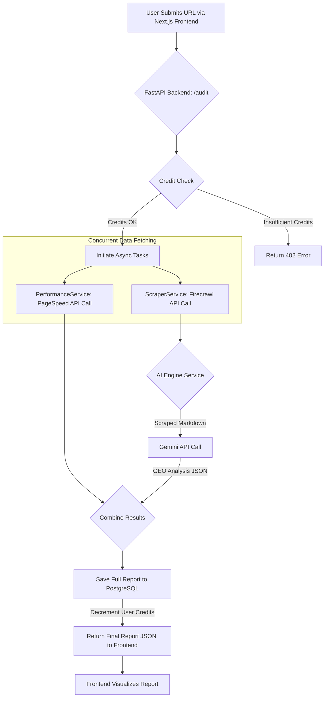
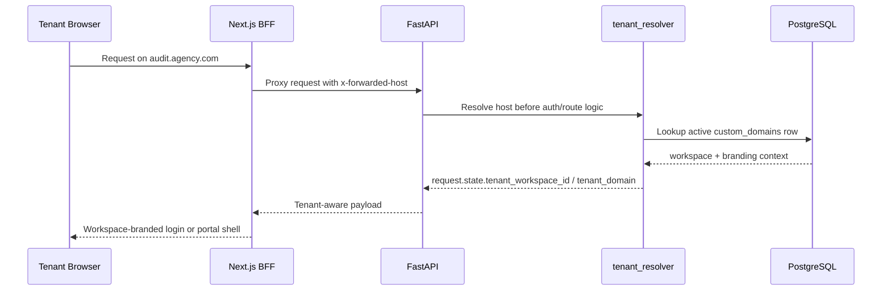
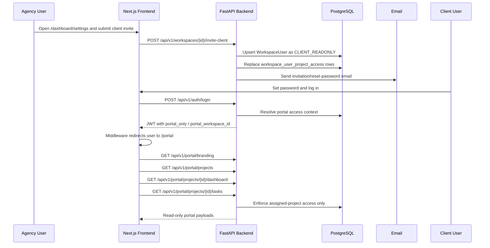
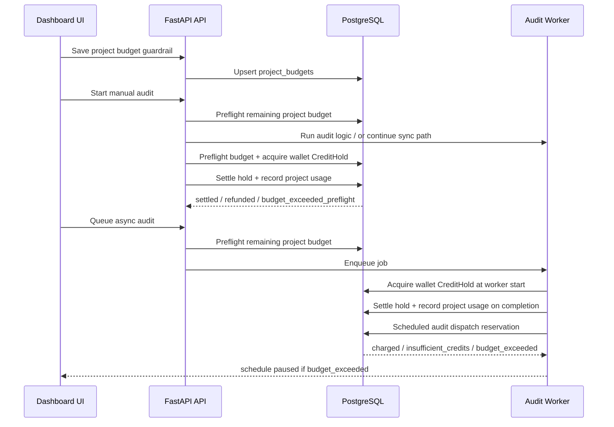
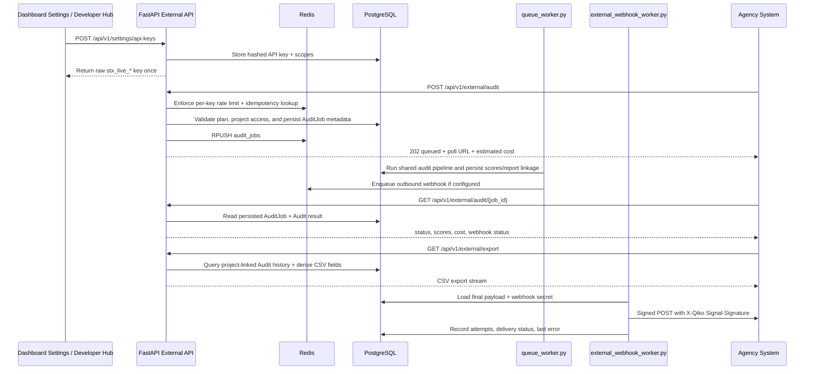
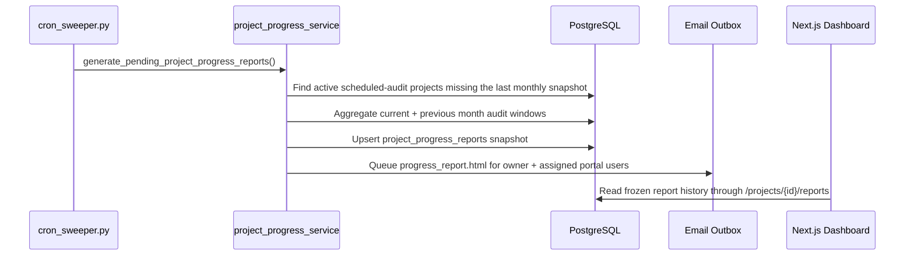
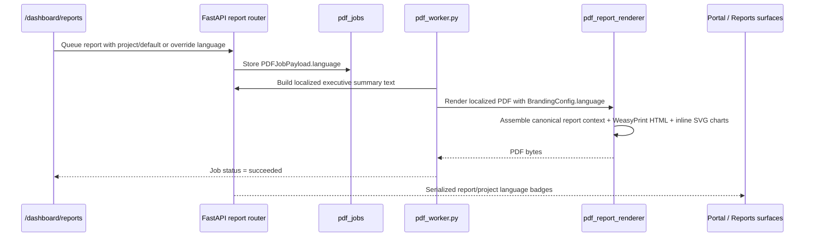
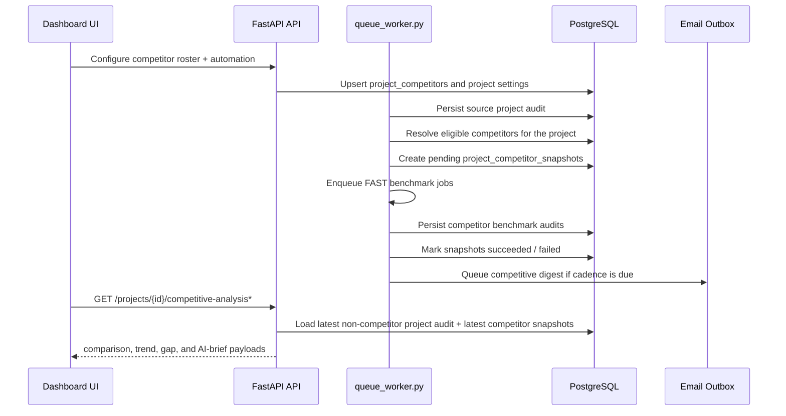
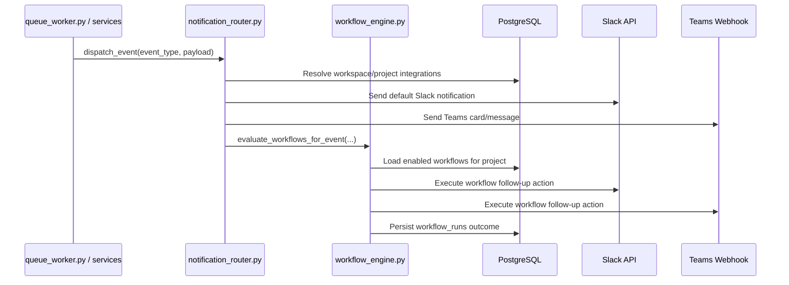

# GEO AEO Audit Tool - Technical Architecture

Last updated: March 13, 2026

This document outlines the technical architecture of the GEO AEO (Generative Engine Optimization & AI Engine Optimization) Audit Tool, a full-stack application designed to analyze web pages and provide insights for improving their visibility in AI-driven search engines.

### Codebase Statistics

| Metric | Count |
| --- | --- |
| **Total lines of code** | ~576,000 (~430K Python + ~146K TypeScript) |
| **Database models** | 109 |
| **Alembic migrations** | 113 |
| **Backend test files** | 244 |
| **Frontend test files** | 162 |
| **Total test files** | 406+ |
| **API routers** | 30 |
| **API endpoints** | 500+ |
| **Backend services** | 118 |
| **Workers** | 10 (`queue_worker`, `pdf_worker`, `email_outbox_worker`, `billing_webhook_worker`, `monitoring_worker`, `visibility_index_worker`, `performance_sync_worker`, `cron_sweeper`, `external_webhook_worker`, `ai_service`) |
| **Email templates** | 40 |
| **Frontend components** | 306 |
| **Plans** | 5 (Explorer Free, Starter, Growth, Specialist, Executive) |
| **AI audit providers** | 5 (Google Gemini, OpenAI, Anthropic, xAI/Grok, DeepSeek) |
| **AI engines tracked** | 8 |

## 1. Stack Overview

The application is built on a modern, containerized stack chosen for performance, scalability, and developer efficiency.

- **Frontend**: **Next.js 16.3.6** using the App Router. This provides a robust framework for building a fast, server-rendered React application. We use Tailwind CSS for utility-first styling. The current presentation contract is the 2026 "Architectural Precision" system with dual-engine AEO/GEO semantics: periwinkle/teal design tokens (`brand.aeo`, `brand.geo`), micro-glow elevated surfaces, a slightly softened radius scale, and display-layer terminology that maps backend audit concepts to user-facing assessment/roadmap language without changing API fields or routes.
- **Backend**: **FastAPI** (Python 3.11). A high-performance web framework for building APIs. Its asynchronous nature is critical for handling I/O-bound tasks like external API calls. Pydantic is used for data validation.
- **Database**: **PostgreSQL 18**. A powerful, open-source object-relational database system, providing reliability and data integrity for storing user data, audit reports, and subscriptions.
- **Caching & Rate Limiting**: **Redis 8**. An in-memory data store used for caching expensive audit results and for implementing rate limiting to protect the API from abuse.
- **Web Scraping**: **Firecrawl**. A specialized service that provides a reliable API to scrape and convert any website into clean, structured Markdown, which is essential for the AI analysis.
- **AI Engine**: **Google Gemini (Flash & Pro)** as the default/primary provider, with **OpenAI**, **Anthropic**, **xAI/Grok**, and **DeepSeek** as additional audit providers for multi-model consensus and provider diversity. The routing policy selects and falls back across all five providers based on tier class, plan entitlement, and runtime health.
- **Audit routing contract**: audit estimate/create/job flows share the same server-side route resolution, so provider choice, tier class, brand-vs-website target identity, and selected multi-model consensus providers stay aligned across forecasting, execution, persisted report metadata, and billing reconciliation.
- **Performance Metrics**: **Google PageSpeed Insights API**. Used to fetch technical performance metrics (LCP, CLS, FCP) for a given URL.
- **Containerization**: **Docker & Docker Compose**. The entire application is containerized, ensuring a consistent development, testing, and production environment.
- **AI Service (optional standalone)**: **FastAPI** service (`backend/ai_service.py`) that encapsulates AI provider orchestration and rate limiting. It can run in the same stack or as a separately deployed service that the backend calls via `AI_SERVICE_URL`.
- **Monitoring & Visibility**: Project monitoring combines SERP tracking, GA4 LLM traffic snapshots, AI bot server-log diagnostics (with spoofing detection), off-page mentions intelligence, AI search volatility index overlays/public weather signal, project-scoped AI visibility queries/results on `/dashboard/projects/[projectId]/monitoring`, entity authority scoring/graph analytics on `/dashboard/projects/[projectId]/entity-authority`, and proprietary benchmark intelligence on `/dashboard/projects/[projectId]`.
- **Project intelligence contracts**: `GET /api/v1/projects/{project_id}` and workspace project-list payloads now expose backend-authored `feature_access` capability states for navigation/plan-lock rendering, and SEO/AEO/GEO project pages resolve audit context through `GET /api/v1/projects/{project_id}/audits/latest-selection?module=...` so compatibility and freshness stay server-driven.

## 2. Data Flow Diagram

The end-to-end audit process follows a clear, orchestrated flow from user input to the final report visualization.



## 2.1 AI Service Deployment Notes

The AI service (`ai-service`) can be deployed as a separate container or process to isolate model calls and scale independently.

- **Entrypoint**: `uvicorn ai_service:app --host 0.0.0.0 --port 8001`
- **Health check**: `GET /health`
- **Backend integration**: the backend and worker call `POST /ai/audit` and read `AI_SERVICE_URL` to locate the service (default `http://ai-service:8001`).
- **Required secrets**: supply at least one provider key (`GEMINI_API_KEY`, `OPENAI_API_KEY`, `ANTHROPIC_API_KEY`, `XAI_API_KEY`, or `DEEPSEEK_API_KEY`).
- **Optional tuning**: retry/backoff (`AI_RETRY_COUNT`, `AI_RETRY_BASE_DELAY`, `AI_RETRY_MAX_DELAY`) with per-provider overrides (`AI_RETRY_COUNT_GOOGLE`, `AI_RETRY_COUNT_OPENAI`, etc.), plus in-memory rate limits per provider/tier (`AI_RATE_LIMIT_PROVIDER_DEFAULT`, `AI_RATE_LIMIT_TIER_DEFAULT`, with per-provider/tier overrides).

## 2.1A Grounded Strategic Insights (AUD-05)

Strategic insight generation for audit detail and project AEO/GEO ideation is now evidence-backed instead of prompt-backed.

- **Route contract**: `POST /api/v1/ai/strategic-insights` accepts `audit_id` and optional `project_id`, requires authenticated access, and still returns the serialized payload through `AIStrategicInsightsResponse.content`.
- **Service boundary**: `backend/services/strategic_insights_service.py` loads the saved audit, canonicalizes the report through `to_canonical_audit_result()`, resolves project access with workspace RBAC, and joins project profile fields, target keywords, project visibility monitoring, and AEO/GEO tracker entries.
- **Tracker semantics**: saved AEO/GEO tracker rows are treated as manual hypotheses only; they can seed pending project visibility queries, but they no longer generate synthetic visibility batches or measured citation wins.
- **Grounding model**: the response includes `grounding_sources`, `priority_roadmap`, `aeo_query_ideas`, and `geo_prompt_ideas`; each idea carries confidence, explicit source basis, verification timestamp when available, and a `measured` / `inferred` / `hypothesis` label.
- **Frontend consumption**: `useAuditHistory`, `AiStrategicInsightsPanel`, `AeoTab`, and `GeoTab` now request grounded insights by saved audit ID and fall back only to persisted tracker history or placeholder messaging rather than synthetic 2026-style suggestions.

## 2.1 Target Contract for Audits (STX-31 + STX-32)

Audit persistence, execution pipeline, and automation infrastructure now support two audit modes:

- **`website`** (existing URL-centric behavior)
- **`brand`** (brand/entity-centric behavior with optional domains)

### Persistence (STX-31)

- **Target fields on persisted rows**:
  - `Audit`: `audit_target_type`, `target_name`, `target_url`, `target_metadata`
  - `AuditJob`: `audit_target_type`, `target_name`, `target_url`, `target_metadata`
- **Compatibility bridge**:
  - legacy `url` remains populated and readable
  - migration backfills `target_url <- url` for historical rows
- **API contract expansion**:
  - audit create/job routes accept `audit_target_type`, `target_name`, `target_url`, `target_metadata`
  - history/job status/project audit endpoints return those fields in addition to legacy `url`
- **Canonical report shape**:
  - top-level `target` object (`type`, `name`, `url`, `metadata`)
  - mirrored metadata keys (`audit_target_type`, `target_name`, `target_url`, `target_metadata`)

### Pipeline Execution (STX-32)

- **Audit runner** (`backend/audit_runner.py`): `perform_audit()` accepts `audit_target_type`, `target_name`, `target_metadata`. Brand audits without a URL skip scraper/performance/network analysis and build AI context from brand metadata and brand_truth_payload.
- **Queue worker** (`backend/queue_worker.py`): brand audit jobs propagate target-type fields to `perform_audit()`. Brand audits without a URL skip site creation and persist with `site_id=NULL`.
- **Workflow engine** (`backend/services/workflow_engine.py`): `run_audit` workflow actions accept `audit_target_type`, `target_name`, `target_metadata` in `action_config`. Brand actions require `target_name`; URL is optional.
- **Scheduled audits**: `ScheduledAuditConfig` includes `audit_target_type`, `target_name`, `target_metadata`. Brand schedules can omit URL. `ScheduledAudit.url` column is nullable. Scheduled dispatch in `queue_worker.py` reads brand fields from `audit_params` and passes them to job payloads.
- **Task sync**: `backend/services/project_task_service.py` already resolves brand target context from `audit.target_name` and `audit.target_metadata` for task derivation.

### Audit Source-of-Truth Rules (AUD-14)

The platform intentionally keeps both relational audit summary fields and the richer `full_report` document. Those copies are not peers; consumers are expected to follow one precedence contract.

- **Rich report content**: `Audit.full_report` is the canonical document for report rendering, recommendation packaging, annotations, PDFs, and evidence-heavy UI.
- **Target identity and public summary scores**: relational audit columns remain authoritative for effective history/detail identity and summary metrics:
  - `audit_target_type`
  - `target_name`
  - `target_url`
  - `target_metadata`
  - `seo_score`
  - `geo_score`
  - `aeo_score`
- **Backend normalization boundary**: `backend/services/audit_normalization_service.py` is the shared backend source of truth for reconciling relational audit fields with `full_report`.
- **Frontend normalization boundary**: `frontend/src/lib/auditHistoryContract.ts` mirrors backend precedence for history/dashboard consumers so frontend adapters do not invent a contradictory score or target source.
- **Historical vs current plan**:
  - `metadata.plan` means the plan persisted with the audit
  - `metadata.current_plan` means the caller's current entitlement when injected by the backend
- **Read-time entitlement sanitization**: `backend/services/audit_normalization_service.py` now applies current-plan payload sanitization before audit detail/history/export responses are serialized. Locked premium sections are physically removed from the JSON payload and exposed only through `metadata.locked_sections`.
- **Legacy compatibility boundary**: old payload shapes remain supported only through shared canonical-first adapters. New consumers should not read raw legacy recommendation or score paths directly when canonical equivalents already exist.

### Scheduled Audit Target Contract (AUD-14D)

Scheduled audits split target state across `scheduled_audits.url` and `scheduled_audits.audit_params`. That state is now treated as one merged contract.

- **Validation boundary**: `backend/app/schemas/scheduling.py::resolve_scheduled_audit_target_contract()` validates the effective merged state for both create and update flows.
- **Website contract**:
  - requires effective `url`
  - clears stale brand-only `target_name` / `target_metadata` fields during normalization
- **Brand contract**:
  - requires effective `audit_params.target_name`
  - may keep `url` as optional supporting context
- **Router persistence**: `backend/routers/scheduling_router.py` persists the resolved canonical contract after `PATCH`, not just the delta fragment.
- **Worker convergence**: `backend/queue_worker.py` reuses the same resolver before enqueue and writes the normalized target contract back to the `ScheduledAudit` row, so legacy mixed rows converge instead of repeatedly dispatching stale target names or metadata.

### Dashboard Consumption (STX-33)

- **Audit workspace configuration** (`frontend/src/components/results/AuditConfigurationForm.tsx`) now includes explicit target-mode selection (`website` vs `brand`) and target-aware validation in `auditFormSchema`.
- **Run orchestration** (`frontend/src/hooks/useAuditRunner.ts`) now sends target fields in audit-job payloads and preserves target identity in completion/history updates.
- **History/results surfaces** (`AuditWorkspace`, project SEO/GEO/AEO pages, project overview, and `/dashboard/reports`) now render target mode + target identity so mixed website/brand audit timelines stay unambiguous.
- **Current runtime behavior**: dashboard brand mode can execute without a website URL; scraper, performance, and network probes run only when a target URL is present, and persisted audits/jobs keep `target_url = NULL` for brand-only runs.

### Marketing / Guest Consumption (STX-34)

- **Guest endpoint contract** (`POST /api/v1/guest-audit`) now accepts target-aware fields:
  - `audit_target_type` (`website | brand`)
  - `target_name`, `target_url`, `target_metadata`
  - legacy `entity` remains accepted for compatibility
- **Brand guest mode without URL**: guest runs can execute with brand-only identity; scraper/performance/network probes are skipped and response insights state this explicitly.
- **Canonical guest response shape** now includes:
  - top-level `target` object (`type`, `name`, `url`, `metadata`)
  - canonical sections (`site`, `seo`, `geo`, `aeo`, `scores`)
  - mirrored metadata target fields
- **Frontend marketing surfaces** (`/guest-audit`, `/share/[auditId]`, `/sample-report`, `/docs`) now render target-type-aware copy/context so public viewers can distinguish brand vs website audits.

## 2.1 Forecast-Aware Audit Billing (STX-36 + STX-37)

Audit charging now has a preflight forecasting layer that feeds credit holds, queue metadata, ledger payloads, and debate runtime guardrails.

- **Forecast service** (`backend/services/cost_forecast_service.py`):
  - computes `SerpComplexitySignal` and `ContentComplexitySignal` from `audit_data`, optional `serp_preview`, entities, and target metadata.
  - resolves model-aware projected usage from routing policy + `core/pricing_matrix.py`.
  - adds SERP API, infra, and orchestration cost components.
  - calibrates projected COGS against recent `AIEconomicsLedgerEntry` rows and can reconstruct actual debate cost from persisted transcript metadata.
- **Router/API surface** (`backend/routers/api_router.py`):
  - `POST /api/v1/audit/estimate` returns forecasted credits, USD cost, confidence, balance sufficiency, and a transparent `breakdown`.
  - audit create/job routes persist `cost_forecast` metadata for sync reports and queued job payloads.
- **Credit-hold integration**:
  - synchronous audits acquire TASK-36 holds from the forecasted credit amount before execution.
  - queued audits and worker fallback rebuilds persist the same forecast family so settlement/reconciliation stays deterministic.
- **Consensus forecasting**:
  - multi-model audit intent is projected as one step per selected provider plus a synthesis step, rather than a single-provider blended estimate.
- **Debate orchestration** (`backend/services/debate_orchestrator.py`):
  - per-step runtime pricing now uses the actual resolved model rates instead of flat tier rates.
  - debate cap is derived from forecasted LLM cost via `DEBATE_COST_CAP_EUR` (legacy `DEBATE_COST_CAP_USD` env remains supported as an alias).
- **Frontend surface**:
  - audit configuration consumes the estimate through `frontend/src/hooks/useAuditRunner.ts` and renders it in `frontend/src/components/results/CreditEstimate.tsx`.
  - the card exposes credits, USD cost, confidence, route, forecast mode, density scores, and insufficient-balance messaging using the existing pre-scan snapshot as the seed when raw SERP data is unavailable.

## 2.1A Project Visibility Monitoring

Project-scoped AI visibility monitoring productizes the existing visibility worker infrastructure into a first-class monitoring surface.

- **Configuration model**: `ProjectVisibilityQuery` stores the tracked prompt text, query type, provider set, active flag, and `schema_version`.
- **Execution model**: `visibility_index_worker.py` now executes both:
  - env-driven global visibility batches
  - project-scoped visibility batches tied to `VisibilityRunBatch.project_id`
- **Aggregation layer**: `backend/services/project_visibility_service.py` is the canonical source for:
  - plan entitlements and provider gating
  - query CRUD validation
  - granular multi-factor aggregate visibility score calculation (0-100 composite from citation presence, citation rank, brand mention density, answer prominence, and temporal stability factors)
  - provider-level breakdowns across expanded provider set: Google Gemini, OpenAI, Anthropic, xAI/Grok, DeepSeek, and Meta AI
  - brand vs competitor visibility comparison graph data
  - project trend points
- **Frontend surface**: `/dashboard/projects/[projectId]/monitoring` now combines:
  - LLM referral traffic with 16 GA4 AI referral source classifications
  - SERP snippet tracking with 12 rendered SERP feature types (featured snippets, knowledge panels, AI overviews, people also ask, video carousels, local packs, image packs, top stories, shopping results, site links, related searches, and direct answers)
  - AI visibility score, query manager, grid, trend chart, and brand vs competitor visibility graph
- **Alert integration**: `AlertRule.metric` now supports `ai_visibility_score`, with email delivery using `alert.visibility_score_drop`.

## 2.1B Project Entity Authority

Project-scoped entity authority turns extracted entities into a persisted moat metric with explainable components and graph drill-down.

- **Aggregation layer**: `backend/services/entity_authority_service.py` computes:
  - `coverage` (target ICP/USP entities detected)
  - `depth` (relevance weighted by log frequency)
  - `consistency` (CoV-derived stability across audits)
  - `uniqueness` (project entities absent from competitor audit baselines)
- **Persistence model**: `EntityAuthoritySnapshot` stores weighted component scores, counts, `computation_version`, and `schema_version`.
- **Router surface**: `backend/routers/entity_authority_router.py` exposes:
  - `GET /api/v1/projects/{project_id}/entity-authority`
  - `GET /api/v1/projects/{project_id}/entity-graph`
  - `GET /api/v1/projects/{project_id}/entity-authority/gaps`
  - `GET /api/v1/projects/{project_id}/entity-authority/trend`
  - `POST /api/v1/projects/{project_id}/entity-authority/compute`
- **Plan gate**: feature key `entity_authority` (Specialist and Executive).
- **Frontend surface**: `/dashboard/projects/[projectId]/entity-authority` with states for loading, empty, no-ICP, plan lock, success, retryable error, and degraded graph rendering.
- **Detailed formulas/doc**: `docs/entity-authority-architecture.md`.

## 2.1C Proprietary Signal Warehouse & Benchmarks

TASK-17 (STX-27) introduces a reusable signal warehouse layer that powers privacy-safe benchmarks and proprietary scoring.

- **Fact model**: `SignalAuditSnapshot`, `SignalDebateAgentFact`, `SignalClaimDispositionFact`, `SignalCitationEvent`, `SignalEntityObservation`, `SignalRemediationOutcome`, `BenchmarkCohortAggregate`, and `ProprietaryScore` in `backend/models.py`.
- **Ingestion service**: `backend/services/signal_ingestion_service.py` provides idempotent:
  - `ingest_audit(...)`
  - `ingest_visibility_batch(...)`
  - `record_remediation_outcome(...)`
  - `backfill_all(...)`
- **Execution hooks**:
  - audit worker integration in `backend/queue_worker.py`
  - visibility worker integration in `backend/services/visibility_index_jobs.py`
  - periodic sweep/backfill in `backend/cron_sweeper.py`
- **Benchmark engine**: `backend/services/benchmark_engine.py`
  - computes cohort aggregates by industry/plan/global fallback
  - enforces suppression thresholds (`k>=10` projects and `>=3` workspaces)
- **Proprietary score registry**: `backend/services/proprietary_score_registry.py`
  - `citation_stability`
  - `remediation_impact`
  - `pipeline_quality`
  - `provider_cost_efficiency`
- **Project APIs** (`backend/routers/benchmark_router.py`):
  - `GET /api/v1/projects/{project_id}/benchmark`
  - `GET /api/v1/projects/{project_id}/citation-stability`
  - `GET /api/v1/projects/{project_id}/remediation-impact`
  - `GET /api/v1/projects/{project_id}/pipeline-quality`
  - `GET /api/v1/projects/{project_id}/provider-cost-efficiency`
  - plan-gated to Specialist / Executive.
- **Orchestra V3 moat alignment**:
  - `SignalAuditSnapshot` now stores additive V3 metadata (`pipeline_type`, `agent_count`, `parallel_layers`, `total_debate_cost_eur`, `total_debate_latency_ms`, `evidence_anchor_json`) without changing legacy V2 ingestion paths.
  - `SignalDebateAgentFact` stores per-agent provider/model/cost/latency/token facts for V3 audits.
  - `SignalClaimDispositionFact` stores per-domain accepted/downgraded/rejected/manual-review/dedup claim counts, with fallback `domain="mixed"` aggregation when only judge summary data is available.
- **EPIC-03 compatibility scaffolding**:
  - `backend/services/unified_truth_context_service.py` reads benchmark percentiles, proprietary score summaries, entity history, and remediation outcomes into additive `signal_intelligence` / `unified_truth_context` payloads.
  - `backend/services/claim_taxonomy_service.py` adds additive claim classification metadata (`track`, `claim_kind`, `classification_basis`, `premise_refs`, `omittable`) to grounding claims without changing the current verdict authority.
  - `backend/audit_runner.py` and `POST /api/v1/ai/prompt-recommendation` now also inject supported `Track A` claims recovered from grounded audit results into `unified_truth_context` when available; `backend/services/strategic_insights_service.py` continues to consume the Signal Warehouse-derived side of that payload.
  - `backend/services/claim_evaluation_service.py` now computes non-authoritative `dual_track_shadow` claim comparisons and persists them under canonical report metadata for auditability during rollout.
  - strategic insights can re-rank recommendations using remediation-category history, but dual-track Judge routing and track-aware integrity certificate behavior are still planned, not active.
- **Admin APIs**:
  - `GET /api/v1/admin/signal-warehouse/health`
  - `POST /api/v1/admin/signal-warehouse/backfill`
- **Frontend surfaces**:
  - project benchmark/proprietary badge on `/dashboard/projects/[projectId]`
  - signal warehouse health/backfill panel on `/admin/overview`.

## 2.1E Embeddable Leads & Sitemap Batch Crawls

TASK-20 (STX-04) introduces two acquisition/scale surfaces that reuse the existing audit queue instead of creating parallel pipelines.

- **Persistence models** (`backend/models.py`):
  - `EmbedApiKey` (`allowed_origins`, `daily_limit`, hashed key storage, `schema_version`)
  - `Lead` (workspace-scoped capture records linked to `audit_jobs`)
  - `SitemapCrawlJob` (batch crawl lifecycle, counters, aggregate payload, `schema_version`)
  - `AuditJob` now supports optional `embed_api_key_id` and `sitemap_crawl_job_id` linkage.

- **Migration**:
  - `backend/alembic/versions/20260305_150000_add_embed_widget_and_sitemap_crawl_tables.py`

- **Router surface** (`backend/routers/embed_router.py`):
  - embed ingestion/polling:
    - `POST /api/v1/embed/audit`
    - `GET /api/v1/embed/audit/{job_id}/status`
  - workspace operations:
    - `GET|POST|DELETE /api/v1/workspaces/{workspace_id}/embed-keys...`
    - `GET /api/v1/workspaces/{workspace_id}/leads`
  - project crawl operations:
    - `POST /api/v1/projects/{project_id}/sitemap-crawl/estimate`
    - `POST /api/v1/projects/{project_id}/sitemap-crawl`
    - `GET /api/v1/sitemap-crawl/{id}`
    - `GET /api/v1/sitemap-crawl/{id}/report`

- **Embed security model** (`backend/services/embed_service.py`):
  - dedicated `stx_embed_*` key format and SHA-256 hash verification.
  - server-side origin enforcement against `EmbedApiKey.allowed_origins`.
  - per-key daily quota enforcement in Redis (`embed_rate:{key_id}:YYYYMMDD`).
  - plan gate uses `lead_widget` capability (`plan_specialist` / `plan_executive`).

- **Sitemap orchestration** (`backend/services/sitemap_crawler_service.py`):
  - parser handles sitemap index, nested sitemaps, and gzip payloads (`.gz` / gzip content-type).
  - upfront credit pre-check before queue fan-out.
  - Redis-backed bounded dispatch (`pending_urls` list + `inflight` counter) with max concurrency 10.
  - worker callbacks finalize progress via `record_page_outcome(...)`, schedule next URLs, and persist aggregate report data.

- **Worker integration** (`backend/queue_worker.py`, `backend/job_models.py`):
  - `AuditJobPayload` includes `sitemap_crawl_job_id`.
  - success/failure branches update crawl counters and trigger aggregation/email on terminal completion.

- **Email delivery**:
  - template keys wired through `EmailService`:
    - `lead.captured` -> `backend/templates/lead_captured.html`
    - `sitemap.crawl_complete` -> `backend/templates/sitemap_crawl_complete.html`

- **Frontend surfaces**:
  - workspace lead ops: `/dashboard/leads` (embed key manager, snippet generator, lead table).
  - project crawl ops: `/dashboard/projects/[projectId]/site-crawl`.
  - standalone embeddable script artifact: `frontend/public/embed/widget.js`.
  - project/workspace navigation updated to expose both surfaces.

## 2.1G LLM Bot Log Analyzer

TASK-24 (STX-22) adds project-scoped AI crawler diagnostics sourced from raw server access logs.

- **Persistence model** (`backend/models.py`):
  - `ProjectBotLogSource` stores connector configuration per project/source type.
  - `ProjectBotLogUpload` stores each ingestion run (filename, status, row counts, bytes, errors).
  - `ProjectBotLogAggregate` stores per-upload dimensions (date, bot, section, status class, verification).
  - `ProjectBotLogDailySummary` stores pre-aggregated daily diagnostics for dashboard reads.
  - `BotLogIngestionSourceType` supports `manual_upload`, `cloudflare_logpush`, `aws_s3`, `gcp_cloud_storage`.

- **Migration**:
  - `backend/alembic/versions/20260305_170000_add_project_bot_log_analyzer_tables.py`

- **Bot registry + parser service** (`backend/services/project_bot_log_analyzer_service.py`):
  - 17 AI crawler bot signatures and verification domains are loaded from `backend/data/ai_bot_user_agents.json`.
  - upload parser streams `.log`, `.txt`, and `.gz` content, matches known AI crawler UAs, and extracts status/path/timestamp dimensions.
  - reverse-DNS verification uses timeout/cache + bounded lookup budget to surface spoofed bot traffic without unbounded resolver stalls.
  - upload aggregates are materialized into daily summaries for fast project monitoring queries.

- **Router surface** (`backend/routers/monitoring_router.py`):
  - `GET /api/v1/projects/{project_id}/monitoring/bot-logs/summary`
  - `GET /api/v1/projects/{project_id}/monitoring/bot-logs/sources`
  - `POST /api/v1/projects/{project_id}/monitoring/bot-logs/sources`
  - `POST /api/v1/projects/{project_id}/monitoring/bot-logs/upload`
  - plan gate: `api_access` (`plan_specialist` / `plan_executive`)
  - write access for source/upload mutation: `ADMIN` / `EDITOR`

- **Worker integration**:
  - `backend/cron_sweeper.py` calls `refresh_recent_bot_log_daily_summaries(...)` to keep recent bot diagnostics server-driven and auditable.

- **Frontend surfaces**:
  - project monitoring panel: `/dashboard/projects/[projectId]/monitoring` (upload, totals, section heatmap, error tracking, spoofing radar, connector-state cards).
  - workspace handoff card: `/dashboard/connections` -> deep-link to project bot log analyzer.

## 2.1H Off-Page AEO Mentions Tracker

TASK-25 (STX-24) adds project-scoped off-page mentions intelligence for high-trust corpus domains.

- **Persistence model** (`backend/models.py`):
  - `ProjectOffPageMention` stores mention-level rows (source domain/url, sentiment, linked keywords, entities, authority, analysis status, metadata, `schema_version`).
  - `ProjectOffPageMentionDailySummary` stores pre-aggregated day-level score and sentiment/domain totals with `schema_version`.

- **Migration**:
  - `backend/alembic/versions/20260305_180000_add_project_off_page_mentions_tables.py`

- **Aggregation/service layer** (`backend/services/project_offpage_mentions_service.py`):
  - stable mention dedupe via fingerprint hash
  - high-trust domain weighting for authority scoring
  - batch NLP analysis (max 20 mentions per call) with semantic-cache reuse and heuristic fallback
  - dynamic AI credit charging for analysis batches with policy-version ledger capture
  - off-page score/trend/advice computation

- **Router surface** (`backend/routers/monitoring_router.py`):
  - `GET /api/v1/projects/{project_id}/monitoring/off-page-mentions/summary`
  - `GET /api/v1/projects/{project_id}/monitoring/off-page-mentions/trends`
  - `GET /api/v1/projects/{project_id}/monitoring/off-page-mentions/feed`
  - `POST /api/v1/projects/{project_id}/monitoring/off-page-mentions/ingest`
  - plan gate: `api_access` (Specialist / Executive)
  - write access for ingestion: `ADMIN` / `EDITOR`

- **Alert integration**:
  - `AlertRule.metric` now supports `aeo_mention_drop`.
  - notifications route through `alert.aeo_mention_drop` with dedicated email template.

- **Worker integration**:
  - `backend/cron_sweeper.py` refreshes recent off-page daily summaries through `refresh_recent_off_page_mention_daily_summaries(...)`.

- **Frontend surface**:
  - `/dashboard/projects/[projectId]/monitoring` now includes an Off-Page AEO Mentions panel with scorecards, top domains, actionable advice, trends, and mention feed.

## 2.1I AI Search Volatility Index

TASK-26 (STX-20) adds a global AI answer volatility sensor that is consumed in both project monitoring and a public acquisition surface.

- **Persistence model** (`backend/models.py`):
  - `GlobalVolatilitySeedQuery` stores normalized seed corpus rows with industry tagging.
  - `DailySeedQueryRun` stores provider/day answer snapshots (text hash, citations hash, domain list, format type, change markers).
  - `GlobalVolatilitySnapshot` stores provider/industry/day aggregate scores, weather label, component metrics, and citation-domain deltas.

- **Migration**:
  - `backend/alembic/versions/20260305_190000_add_ai_search_volatility_index_tables.py`

- **Computation/service layer** (`backend/services/ai_search_volatility_service.py`):
  - day-over-day comparison uses cosine similarity for normalized answer text and Jaccard/churn logic for citation domains.
  - volatility score (0-10) is derived from changed-query ratio plus weighted similarity/churn/format-change signals.
  - supports summary/trend/public payload generation and project-trend overlay mapping.
  - bootstraps a default seed query corpus and enforces minimum sample safeguards before publishing a non-degraded score.

- **Worker integration**:
  - `backend/services/visibility_index_jobs.py` caches repeat prompt responses (23h semantic cache TTL) and ingests completed global runs into `DailySeedQueryRun`.
  - `backend/visibility_index_worker.py` schedules volatility seed sampling via:
    - `VOLATILITY_INDEX_ENABLED`
    - `VOLATILITY_PROVIDERS`
    - `VOLATILITY_SCHEDULE_SECONDS`
    - `VOLATILITY_SEED_QUERY_LIMIT`
  - `backend/cron_sweeper.py` periodically rebuilds recent global snapshots for continuity/auditability.

- **Router surface**:
  - project endpoints (`backend/routers/monitoring_router.py`):
    - `GET /api/v1/projects/{project_id}/monitoring/ai-search-volatility/summary`
    - `GET /api/v1/projects/{project_id}/monitoring/ai-search-volatility/trends`
    - plan gate: `api_access` (Specialist / Executive)
  - public endpoint (`backend/routers/api_router.py`):
    - `GET /api/v1/volatility/public` (no auth)

- **Historical trends integration**:
  - `backend/services/project_progress_service.py` now attaches optional `volatility_score` points to project trend buckets.
  - `/dashboard/projects/[projectId]/timeline` renders this signal as a dedicated overlay series.

- **Frontend surfaces**:
  - project panel on `/dashboard/projects/[projectId]/monitoring` (`ProjectVolatilityIndexPanel`).
  - public sensor dashboard on `/volatility` with a 0-100 gauge, 30-day trend chart, date-scrubbable industry heatmap matrix, citation movement ledger, and alert-rule preview canvas.

## 2.1J Model Lifecycle Monitoring

EPIC-PHASE-11 introduces runtime model lifecycle monitoring to track provider model deprecations, capability changes, and availability shifts across all five AI providers.

- **Service layer**: `backend/services/model_lifecycle_monitor_service.py` provides:
  - periodic polling of provider model catalogs and deprecation notices
  - runtime model availability and capability state resolution
  - deprecation timeline alerts and automatic fallback route recommendations
  - integration with `backend/services/ai_provider_runtime_service.py` for health/quota state
- **Provider picker UI**: enterprise-plan-gated provider selection surface that exposes runtime model state, availability badges, and capability metadata so operators can make informed provider choices before audit execution.
- **Alert integration**: model deprecation and capability-change events route through the existing notification pipeline with dedicated alert templates.

## 2.1K Concurrent Audit Worker & Priority Queues

The audit worker infrastructure now supports concurrent job processing with priority queue semantics.

- **Worker model**: `backend/queue_worker.py` now supports concurrent audit execution with configurable parallelism, replacing the sequential single-job processing model for high-throughput workspaces.
- **Priority queues**: audit jobs are classified into priority tiers (critical, high, normal, low) based on plan tier, job source (scheduled vs manual vs API), and workspace SLA configuration. Higher-priority jobs are dequeued and dispatched before lower-priority work.
- **Backpressure and fairness**: the worker enforces per-workspace concurrency limits and global capacity ceilings to prevent any single workspace from monopolizing shared infrastructure.
- **Observability**: priority queue depth, per-tier latency, and worker utilization metrics are exposed through the existing admin observability surface.

## 2.1L Claim Feedback Loop

Claim feedback extends the existing claim review workflow into a closed-loop learning signal.

- **Feedback model**: agency reviewers and portal users can submit structured feedback on individual audit claims (approve, dispute, flag as outdated, request clarification), persisted alongside the existing `claim_review_decisions` rows.
- **Aggregation**: feedback signals are aggregated per claim domain and recommendation category to surface systematic grounding accuracy patterns.
- **Downstream consumption**: `backend/services/strategic_insights_service.py` and the Signal Warehouse ingest claim feedback dispositions as remediation outcome signals, closing the loop between human review and future audit quality.

## 2.1M AI Case Study Generator

Project-scoped AI case study generation converts historical audit progress, competitive gains, and visibility improvements into publishable narratives.

- **Service layer**: the case study generator consumes project audit history, progress report snapshots, competitive analysis deltas, and visibility trend data to produce structured case study documents with evidence-backed claims.
- **Generation flow**: follows the same queue-backed AI pipeline pattern used across AI generation features — route resolution through `ai_routing_policy`, dynamic credit charging, and economics ledger capture.
- **Frontend surface**: accessible from the project reports workspace, with generation controls, preview rendering, and export actions.

## 2.1N Guest Audit with Rate Limiting

Guest audit infrastructure now includes comprehensive rate limiting and abuse prevention.

- **Rate limiting model**: guest audit submissions are rate-limited by IP address, fingerprint hash, and optional email with configurable daily and hourly caps stored in Redis.
- **Abuse prevention**: progressive challenges (CAPTCHA escalation) activate when rate thresholds approach limits, and repeated violations trigger temporary IP-level blocks.
- **Conversion tracking**: guest audit completions now feed into the lead capture pipeline when the guest provides contact information, bridging the marketing funnel with workspace lead management.

## 2.1O In-App Plan Upgrade/Downgrade & Explorer Free Plan

The billing module now supports self-serve plan changes and a zero-cost entry tier.

- **Explorer Free plan**: a new zero-cost plan tier that provides limited audit credits, basic visibility monitoring, and access to the guest audit surface. The plan capability matrix (`backend/core/plan_capabilities.py`) includes `explorer_free` with its own entitlement boundaries.
- **In-app upgrade/downgrade**: `/dashboard/billing` now supports self-serve plan transitions through Stripe Checkout (upgrades) and Stripe Billing Portal (downgrades), with proration handling and immediate entitlement updates on webhook confirmation.
- **Plan transition lifecycle**: `backend/billing/router.py` validates transition eligibility, computes proration, and creates Checkout sessions or portal links. `backend/billing_webhook_worker.py` fulfills plan change events and reconciles credit grants, commitment adjustments, and capability changes atomically.
- **Downgrade safeguards**: plan downgrades that would exceed the target plan's project/query/competitor limits surface explicit warnings and require the user to resolve over-limit resources before the transition completes.

**Flow Explanation:**

1.  **User Input**: The user enters a URL on the Next.js frontend and starts the audit.
2.  **API Request**: The frontend sends the audit tier class (`fast` or `deep`) plus targeting context to the FastAPI audit endpoint.
3.  **Server-side Routing**: The backend resolves the effective provider/model route from `backend/services/ai_routing_policy.py` and ignores legacy manual provider selection fields for dashboard audit starts.
    The same policy object now also owns Thoth support chat routing (`openai/lite` primary, `google/fast` fallback) and route metadata for lightweight AI micro-tasks.
    Provider selection now also checks runtime provider state from `backend/services/ai_provider_runtime_service.py` (health/quota/config) before finalizing a route.
4.  **Credit Reservation**: On cache miss, the backend preflights the project budget and acquires a `CreditHold` against the shared wallet before expensive audit execution begins.
5.  **Concurrent Fetching**: The backend asynchronously initiates two parallel tasks:
    - **Firecrawl Scraper**: Fetches the page content as clean Markdown.
    - **PageSpeed Insights**: Fetches technical performance metrics.
6.  **AI Analysis**: Once the scraping is complete, the Markdown content is sent to the `AIEngineService`.
7.  **Gemini Audit**: The current policy routes audit starts to Gemini Flash/Pro families based on the resolved tier class.
8.  **Data Aggregation**: The results from the AI audit and PageSpeed are combined into a single comprehensive JSON report.
9.  **Settlement + Storage**: The audit hold is settled (or refunded on failure/non-billable outcomes), project usage is recorded from the settled amount, and the full report is saved to the `Audits` table with routing and hold metadata for observability.
10. **Frontend Visualization**: The final report is sent back to the Next.js frontend, where it is parsed and displayed to the user in a structured format.

For low-cost AI helpers outside the main audit path, `backend/services/semantic_cache_service.py` stores Redis-backed semantic cache entries for normalized pre-scan snapshots and site-classification content excerpts, reducing repeated micro-task calls without affecting the full audit cache.

## 2.2 Authentication Architecture (Custom JWT)

Runtime authentication now uses the built-in custom auth stack only (no third-party hosted identity provider in request flow).

- **Login**: frontend submits credentials to `POST /api/v1/auth/login` through the Next.js BFF route (`/api/auth/login`).
- **Token issuance**: backend signs short-lived access tokens with `JWT_SECRET_KEY` and long-lived refresh tokens with `JWT_REFRESH_SECRET_KEY` (`HS256`).
- **Token storage/use**: frontend stores tokens via `token-manager` and sends `Authorization: Bearer <access_token>` on authenticated API routes.
- **Refresh lifecycle**: when access tokens expire, frontend exchanges a valid refresh token for a new access token pair.
- **Email verification**: verification links carry JWT payloads signed with `JWT_SECRET_KEY`; expiry is controlled by `EMAIL_TOKEN_EXPIRE_HOURS` and enforcement by `EMAIL_VERIFICATION_REQUIRED`.
- **Verification resend**: `POST /api/v1/auth/resend-verification` now accepts `{ email }`, applies per-email 60-second throttling, and returns enumeration-safe responses.
- **Password reset**: reset links use signed JWT tokens with expiry controlled by `PASSWORD_RESET_TOKEN_EXPIRE_HOURS`.
- **MFA challenge enforcement**: if a user has `users.mfa_secret`, login requires a valid `mfa_code` TOTP value. Missing/invalid codes return `401` with `mfa_required=true` so frontend can switch to MFA prompt mode.
- **TOTP replay protection and per-user throttle (SIGV2-1244)**: login burns the accepted TOTP timestep in Redis (`mfa:totp:used:{user_id}:{timestep}`, `SET NX` with a TTL covering the whole `valid_window`), so a code works exactly once. Failed MFA attempts are counted per user (`mfa:attempts:{user_id}`): 10 failures in 15 minutes return `429` with `Retry-After` regardless of source IP, and a successful verification clears the counter. The replay guard is fail-closed (a Redis outage returns `503`, never a pass); the throttle counter is fail-open so an outage cannot lock everyone out.
- **MFA management endpoints**: account security uses:
  - `GET /api/v1/users/me/mfa/status`
  - `POST /api/v1/users/me/mfa/setup`
  - `POST /api/v1/users/me/mfa/enable`
  - `POST /api/v1/users/me/mfa/disable`
- **MFA enrollment binding (SIGV2-1241)**: `enable` only accepts the server-minted, user-bound `setup_token` issued by `setup`. A client-supplied TOTP `secret` is never accepted, and a request without a valid `setup_token` is rejected with a `4xx`.
- **Authentication**: Local and production environments both use the real JWT/OAuth authentication flows.
- **Frontend auth UX normalization (TASK-22 / STX-25)**: login/register/forgot/reset/verify/callback now share reusable state primitives, consistent copy, provider-scoped SSO loading states, and explicit callback recovery states (`provider_error`, `expired_code`, `invalid_state`) without changing backend auth contracts.
- **Frontend auth UX polish (TASK-42 / STX-42)**: tenant branding resolution is now propagated across all auth pages, password policy logic is centralized in shared frontend validation, register/reset forms surface live password strength guidance, and registration enforces Terms/Privacy consent.

## 2.3 Account Settings Architecture

Account settings are implemented as a full-stack capability, not a UI placeholder.

- **Frontend page**: `frontend/src/app/(app)/dashboard/account-settings/page.tsx`.
- **BFF routing**: Next.js routes under `frontend/src/app/api/users/me/**` proxy authenticated requests to backend `api/v1/users/me/**`.
- **Primary backend contracts**:
  - profile read/update: `GET /api/v1/users/me/profile`, `PATCH /api/v1/users/me`
  - onboarding state: `GET /api/v1/users/me/onboarding`, `PATCH /api/v1/users/me/onboarding`
  - password change: `POST /api/v1/users/me/password`
  - notifications: `GET|PUT /api/v1/users/me/notification-preferences`
  - GDPR unsubscribe: `GET /api/v1/auth/unsubscribe?token=<unsubscribe_token>` — one-click opt-out that sets `notifications_enabled=false`
  - branding: `GET|PUT /api/v1/users/me/branding` (workspace-aware when the user belongs to a workspace, legacy user fallback otherwise)
  - data rights: `GET /api/v1/users/me/data-export`, `DELETE /api/v1/users/me`
- **Plan gating**: white-label branding updates are enforced server-side with `_require_plan_feature(..., feature_key="has_white_label")`.

## 2.3A Workspace White-Label & Tenant Routing

White-label reseller mode extends branding beyond PDFs and the portal by making branding a workspace-owned concern and by resolving incoming tenant hosts back to the correct workspace.

### Data model

- `workspaces` now store the effective white-label fields:
  - `custom_logo_url`
  - `company_name`
  - `primary_color`
  - `secondary_color`
  - `custom_favicon_url`
  - `custom_page_title`
  - `custom_meta_description`
  - `hide_powered_by`
  - `email_sender_name`
  - `email_reply_to`
  - `social_facebook_url`
  - `social_x_url`
  - `social_instagram_url`
  - `social_linkedin_url`
  - `social_youtube_url`
  - `social_tiktok_url`
  - `company_address`
  - `company_legal_name`
  - `company_trademark_text`
  - `footer_about_url`
  - `footer_blog_url`
  - `footer_support_url`
  - `footer_legal_url`
  - `footer_preferences_url`
  - `footer_privacy_url`
- `custom_domains`
  - `workspace_id`
  - `domain`
  - `dns_target`
  - `verified`
  - `ssl_status`
  - `verification_error`
  - `verification_checked_at`
  - `activated_at`
  - `schema_version`

The migration backfills workspace branding from the historical owner-level branding fields so the portal and report flows keep working during rollout.

### Runtime request resolution



The same host forwarding path is used for server-rendered fetches so tenant branding works in the login page and, together with the authenticated white-label settings payload, drives the portal plus dashboard/project audit shells with workspace-resolved title, favicon, color-token, and powered-by behavior.

### Backend contracts

- `GET /api/v1/workspaces/current/white-label`
- `PUT /api/v1/workspaces/current/white-label`
- `GET /api/v1/workspaces/current/email-footer`
- `PATCH /api/v1/workspaces/current/email-footer`
- `POST /api/v1/workspaces/current/white-label/domains`
- `POST /api/v1/workspaces/current/white-label/domains/{domain_id}/verify`
- `DELETE /api/v1/workspaces/current/white-label/domains/{domain_id}`
- `GET /api/v1/tenants/current-branding`

`/api/v1/portal/branding`, invite emails, and white-label report defaults now resolve branding from the workspace first. The legacy `/api/v1/users/me/branding` route remains in place for compatibility, but writes target the current workspace when one exists.

### Activation providers

- Base path: DNS ownership is verified by the app against `CUSTOM_DOMAIN_CNAME_TARGET`.
- Recommended production path: if `CLOUDFLARE_API_TOKEN` and `CLOUDFLARE_ZONE_ID` are present, the same verification step creates or refreshes a Cloudflare for SaaS custom hostname and maps its activation lifecycle into the persisted `ssl_status`.
- Fallback path: without Cloudflare credentials, the app keeps the origin-managed activation flow and relies on the deployed edge configuration to honor verified domains.

### Frontend surfaces

- `/dashboard/settings`
  - white-label branding form
  - plan-lock state for non-elite plans
  - preview card
  - custom-domain setup and verification list
- `/login`
  - tenant-aware title, favicon, logo, and accent colors via `GET /api/v1/tenants/current-branding`
- `/portal/projects/[projectId]`
  - portal shell applies workspace favicon/title and can hide the powered-by treatment

### Current boundary

The application tracks DNS verification and an `ssl_status` lifecycle. With Cloudflare for SaaS configured, edge certificate activation is managed via Cloudflare custom hostnames. Without it, the VPS Caddy config remains the origin-side fallback for verified domains.

## 2.4 Client Portal & Advanced RBAC Architecture

The platform now supports a dedicated client-facing portal that is isolated from the agency dashboard and backed by project-scoped RBAC.

### Core model

- `WorkspaceRole` includes `CLIENT_READONLY`.
- Client access is deny-by-default and materialized through `workspace_user_project_access`, which maps one workspace membership to one or more allowed projects.
- Jira tasks shown in the portal are persisted in `project_jira_exports` so the portal does not depend on browser-local state.
- Access tokens include lightweight routing claims:
  - `portal_only`
  - `portal_workspace_id`

These JWT claims are used only for frontend routing and UX branching. Backend authorization still resolves live membership and project access from PostgreSQL on every protected request.

### End-to-end flow



### Enforcement layers

1. Token minting:
   `backend/services/auth_service.py` derives `portal_only` and `portal_workspace_id` from workspace memberships when creating access tokens.
2. Edge routing:
   `frontend/src/middleware.ts` decodes the access token from the auth cookie and redirects portal-only users away from `/dashboard` and `/admin` into `/portal`.
3. Server-rendered app layout gating:
   `frontend/src/app/(app)/layout.tsx` redirects portal-only sessions to `/portal`, while `frontend/src/app/(portal)/portal/layout.tsx` rejects non-portal users.
4. Backend authorization:
   `backend/services/workspace_rbac.py` keeps standard workspace/project helpers agency-only by default and exposes explicit portal resolvers for read-only assigned-project access.
5. Sensitive surface blocking:
   billing, account settings, branding settings, workspace management, and audit mutation endpoints reject portal-only users even if they bypass frontend routing.
6. Local/dev invitation fallback:
   when outbound mail is disabled, the invite endpoint still returns a valid onboarding URL and the agency settings UI exposes it for manual delivery.

### Portal contract

Portal users are allowed only through dedicated read APIs:

- `GET /api/v1/portal/branding`
- `GET /api/v1/portal/projects`
- `GET /api/v1/portal/projects/{project_id}/dashboard`
- `GET /api/v1/portal/projects/{project_id}/tasks`
- `GET /api/v1/portal/projects/{project_id}/audits/{audit_id}/annotations`
- `POST /api/v1/portal/projects/{project_id}/audits/{audit_id}/annotations`

Portal responses intentionally exclude:

- billing and subscription state
- credit balances and consumption
- audit configuration and model selection
- workspace members
- internal notes, keys, and settings
- projects not explicitly assigned to the client membership

### Frontend route plan

The portal lives in a dedicated Next.js route group:

- `frontend/src/app/(app)/dashboard/settings/page.tsx` is the agency-side entry point for creating and updating portal invitations
- `frontend/src/app/(portal)/portal/layout.tsx`
- `frontend/src/app/(portal)/portal/page.tsx`
- `frontend/src/app/(portal)/portal/projects/[projectId]/page.tsx`

The layout loads agency branding and assigned projects, then renders a minimal shell with project navigation only. Audit execution, billing, plan badges, and workspace settings are intentionally absent from this surface. When accessed through an active custom domain, the same shell inherits workspace favicon/title overrides through the tenant branding flow described above.

For deeper implementation detail, see `docs/client-portals-rbac.md`.

## 2.5 Project Budget Guardrails & Workspace Cost Controls

Project budget guardrails layer hard per-project monthly caps on top of the existing global `User.credits` wallet. They do not create separate balances; they gate how much of the shared wallet a single project may consume inside one billing window.

### Data model

- `project_budgets`
  - one row per project when a cap is configured
  - stores `monthly_limit_credits` and `cycle_anchor_day`
- `project_budget_usage_periods`
  - append-only per-project usage windows keyed by `(project_id, period_start)`
  - stores the effective period start/end, consumed credits, threshold notifications, and the budget limit effective for that period snapshot

This design avoids a reset cron for counters. The current period is derived from the configured anchor day, and a new usage row is created lazily when a project first consumes credits in that window.

### Enforcement strategy



### Concurrency and correctness

1. `backend/services/project_budget_service.py` remains the single source of truth for budget accounting, while `backend/services/credit_hold_service.py` owns wallet reservations.
2. `CreditHold` acquires the wallet reservation first (`SELECT ... FOR UPDATE` on the user row plus atomic wallet decrement), then settles or refunds after execution.
3. Project usage is recorded from the settled hold amount so the wallet is not decremented twice.
4. Budget exhaustion still returns a business outcome distinct from insufficient global credits during preflight:
   - `insufficient_credits` keeps the current wallet semantics
   - `budget_exceeded` blocks only that project and pauses only that project's scheduled audits
5. `cron_sweeper.py` expires stale pending holds and restores wallet credits if a run never settles.

### Frontend surfaces

- `frontend/src/app/(app)/dashboard/projects/[projectId]/settings/page.tsx`
  - `Budget Guardrails` card for cap configuration, current burn, and history
- `frontend/src/app/(app)/dashboard/settings/page.tsx`
  - `Project Cost Breakdown` section for workspace-wide oversight
- `frontend/src/components/results/ScheduleAutomation.tsx`
  - explicit paused-state copy for `budget_exceeded`

### Notification behavior

- Crossing 80% of a configured cap queues `budget.warning`
- Reaching 100% queues `budget.exceeded`

## 2.5A Headless External API Product

The platform now exposes a public headless audit product for enterprise agencies that want to orchestrate audits from their own systems instead of the dashboard UI.

### Auth and eligibility model

- API credentials are persisted in `api_keys` with hashed key storage, key prefix metadata, scopes, active/revoked state, and `last_used_at`.
- Management of those credentials stays JWT-authenticated through `backend/routers/api_keys_router.py`.
- Public execution lives under `backend/routers/external_api_router.py` and uses API-key auth from `backend/services/external_api_service.py`.
- Plan gating is enforced against the normalized capability matrix so only active `plan_specialist` and `plan_executive` subscriptions can use the product.
- API-key scopes come from one closed allow-list, `API_KEY_SCOPES` in `backend/services/external_api_service.py`. It is what `GET /api/v1/external/sdk-metadata` advertises, what `require_api_key_scope` enforces, and the only thing key creation accepts; `backend/tests/test_api_key_scopes.py` pins the three to each other.
- A key created without an explicit scope list gets the read-only subset, so `audit:write` and the other write scopes are granted only when asked for.

### Request lifecycle



### Persistence and worker integration

- `AuditJob` stores the external source, API key linkage, project linkage, provider/tier, estimated and consumed credits, idempotency hash, and webhook delivery status.
- `backend/services/export_service.py` centralizes connector-facing CSV queries, project access scoping, and derived `entity_count` / `recommendation_count` fields from `Audit.full_report.analysis`.
- The shared `queue_worker.py` remains the execution engine so headless API jobs are billed and processed identically to dashboard-submitted audits.
- Outbound callbacks are decoupled into `backend/services/external_webhook_service.py` plus `backend/external_webhook_worker.py`, started through `backend/scripts/start-external-webhook-worker.sh`, which retries failed deliveries with backoff and stores delivery metadata on the job row.

### Rate limits and error contracts

- Limits are Redis-backed and keyed per API key, not per IP.
- Current plan limits:
  - `plan_specialist`: `60 req/min`, `1000 req/day`
  - `plan_executive`: `300 req/min`, `10000 req/day`
- External responses expose `X-RateLimit-Limit`, `X-RateLimit-Remaining`, `X-RateLimit-Reset`, and `Retry-After` on `429`.
- External route validation and HTTP failures are normalized into the `{ "error": { "code", "message", "status" } }` envelope so downstream systems can safely parse failures.

### Frontend surfaces

- `/dashboard/settings`
  - user-facing API key provisioning, one-time secret reveal, revoke flow, and plan-lock messaging
- `/dashboard/developer`
  - operator-facing hub with plan snapshot, delivery notes, and a dedicated section subnavigation
- `/dashboard/developer/docs`
  - dashboard-native API documentation surface with endpoint contracts, CSV connector setup, request/response examples, error envelope, webhook verification, and copyable starter code

The `/dashboard/connections` Looker Studio / Google Sheets setup cards and the
`external/connectors/*` Google Apps Script packaging assets (Community Connector + Sheets
Add-on, both still draft, never published) were removed. The headless export API above is
unaffected; it just no longer has dedicated BI-tool onboarding cards in the UI.

## 2.5C GCS File Storage, Logo Upload, and PDF Retention

Task 28 introduces a storage abstraction that moves logo and complex-report file handling away from DB-sized base64 payloads and startup-only local cleanup patterns.

### Storage service boundary

- `backend/services/gcs_storage_service.py` is the canonical file-storage layer:
  - `upload_file`, `download_file`, `delete_file`, `list_files`, `cleanup_expired`
  - URI-aware helpers for `gs://`, `local://`, and legacy local path fallbacks
  - `generate_signed_url` + `to_public_url` helpers for external links
- Runtime behavior:
  - when `GCS_BUCKET_NAME` is configured and client init succeeds, assets are stored in GCS
  - when not configured (or upload fails), storage falls back to `LOCAL_STORAGE_ROOT` (`backend/generated_storage` default)
  - local fallback path is created on first write and must be writable by the runtime user (`appuser` in Docker)

### Configuration and retention model

- `backend/core/config.py` now exposes:
  - `GCS_BUCKET_NAME`
  - `GCS_REPORTS_PREFIX`
  - `GCS_LOGOS_PREFIX`
  - `GCS_REPORT_RETENTION_DAYS`
  - `GCS_SIGNED_URL_EXPIRY_MINUTES`
  - `LOCAL_STORAGE_ROOT`
- `OperationalSetting.report_retention_days` is persisted for admin-managed report retention (`30`, `60`, `90`), with migration:
  - `backend/alembic/versions/20260306_110000_add_report_retention_days_to_operational_settings.py`

### API contracts and worker flow

- Upload API (`backend/routers/upload_router.py`):
  - `POST /api/v1/uploads/logo`
    - multipart upload (`image/png`, `image/jpeg`, `image/svg+xml`, `image/webp`)
    - max size `2MB`
    - plan gate: `has_white_label`
    - returns URL + object URI + storage type
  - `GET /api/v1/uploads/logo/local/{object_path}`
    - local fallback serving endpoint (non-public schema surface)
- Complex report lifecycle:
  - `pdf_worker.py` stores generated report bytes through storage service and persists URI-like `file_path`
  - `backend/services/pdf_report_renderer.py` now acts as a thin compatibility layer over `backend/services/pdf_reports/`, where canonical report assembly, shared templates, branding tokens, and inline SVG chart generation live
  - `backend/services/pdf_reports/report_suite_service.py` now owns DB-backed report-suite orchestration for `standard`, `executive`, `project`, `competitors`, and `financial` exports, and both report routes plus `pdf_worker.py` hand normalized `export_manifest.report_kind` through that service instead of treating legacy `report_type` as the source of truth
  - the report-suite service assembles executive blueprint context from project/data-source bindings, project reports from persisted audit history plus project tasks, competitor reports from tracked project competitor snapshots, and financial reports from `AuditJob`/`CreditHold`/budget usage records with render-time `hide_credit_cost` redaction
  - `GET /api/v1/reports/complex/{report_id}/download` resolves file content from storage URI/local fallback and returns `410` if expired or unavailable
  - `GET /api/v1/reports/complex/{report_id}/status` now includes `expired` and `retention_days`
- Admin ops:
  - `GET /api/v1/admin/operations` now includes `report_retention_days`
  - `POST /api/v1/admin/operations/report-retention` updates retention policy

### Sweeper and UI integration

- `cron_sweeper.py` now runs `_cleanup_expired_report_jobs(...)`:
  - marks stale `ComplexReportJob` rows as `expired`
  - deletes associated storage objects
  - sweeps orphaned report objects by `GCS_REPORTS_PREFIX`
- Frontend surfaces:
  - branding upload dropzone on `/dashboard/settings` and `/dashboard/account-settings`
  - admin retention selector on `/admin/settings`
  - expired report badges on `/dashboard/projects/[projectId]/reports` and `/portal/projects/[projectId]`

## 2.6 Historical Trends & Automated Progress Reports

Historical trend analytics now sit directly on top of persisted project audit history and power both operator dashboards and client-facing proof-of-value reporting.

### Data model

- `audits`
  - remains the source of truth for raw GEO / SEO / AEO score history
  - trend queries use the existing `(project_id, created_at)` index
- `project_progress_reports`
  - stores one immutable monthly snapshot per `(project_id, report_month)`
  - captures the full report payload (`snapshot`) so the generated report stays viewable even if future audits change the live aggregates

### Backend contracts

- `GET /api/v1/projects/{project_id}/trends`
  - aggregates audits into `daily`, `weekly`, or `monthly` buckets
  - supports `7d`, `30d`, `90d`, `1y`, and `all`
- `GET /api/v1/projects/{project_id}/trends/comparison`
  - compares the current bounded window against the immediately preceding window of equal size
- `GET /api/v1/workspaces/{workspace_id}/trends/overview`
  - returns sparkline-ready project summaries for the dashboard overview
- `GET /api/v1/projects/{project_id}/reports`
  - lists stored monthly snapshots
- `GET /api/v1/projects/{project_id}/reports/{report_id}`
  - returns a single frozen snapshot
- `POST /api/v1/projects/{project_id}/reports/generate`
  - generates or refreshes a monthly snapshot manually, optionally queueing email delivery

The implementation lives in `backend/services/project_progress_service.py`, which centralizes aggregation math, month-over-month comparison, recipient resolution, and snapshot generation.

### Automation and delivery



`cron_sweeper.py` now does more than stale-job cleanup: on the 1st of the month it generates missing reports for active scheduled-audit projects and queues delivery through the existing outbox pipeline.

### Frontend surfaces

- `frontend/src/app/(app)/dashboard/projects/[projectId]/timeline/page.tsx`
  - now acts as a trend intelligence surface instead of a simple list of prior audits
- `frontend/src/app/(app)/dashboard/projects/[projectId]/reports/page.tsx`
  - monthly report center for previewing snapshots and triggering generation/email
- `frontend/src/app/(app)/dashboard/overview/page.tsx`
  - shows per-project sparkline and overall momentum on the workspace landing view

### UX states

- Loading: dedicated skeleton/loader for both timeline analytics and report history.
- Empty: projects without enough audit history get a baseline CTA to run an initial audit.
- Success: trend chart, deltas, report list, report snapshot, and workspace sparklines all render from dedicated APIs.
- Error: failed trend/report loads surface inline copy instead of crashing or silently hiding the module.
- Scheduled audits that hit the cap pause with `ScheduledAuditPauseReason.BUDGET_EXCEEDED`

## 2.6AA Multi-Language Report Delivery

Localized report delivery is implemented as a backend-owned concern so PDFs, report emails, and visible report metadata stay consistent across dashboard, worker, and portal surfaces.

### Translation and rendering model

- `backend/services/report_i18n_service.py`
  - normalizes requested language codes
  - loads static copy from `backend/i18n/*.json`
  - applies English fallback for missing keys or unsupported locales
- `backend/services/pdf_report_renderer.py`
  - consumes localized labels for white-label and comparative PDFs
  - emits localized AI disclaimer copy and section titles
  - gates Japanese and Chinese rendering through CJK-capable ReportLab fonts
- `backend/services/email_templates.py`
  - resolves localized client-facing email copy and subject lines
  - injects the final `lang` into `base_email.html`

### Report job propagation



The critical design rule is that `/dashboard/reports` no longer generates PDFs in the browser. All exported reports now go through the same queue-backed backend pipeline used by workers and stored report delivery, which keeps language resolution, branding, and fallback behavior centralized and auditable.

### Frontend surfaces

- `frontend/src/app/(app)/dashboard/reports/ReportsPageClient.tsx`
  - language override dropdown
  - queued export polling
  - CJK notice for `ja` / `zh`
- `frontend/src/components/dashboard/ProjectProgressReportsClient.tsx`
  - report language badges on stored monthly snapshots
- `frontend/src/app/(portal)/portal/projects/[projectId]/page.tsx`
  - project/report language visibility for portal users

### Current language set

Phase 1 supported locales:

- `en`, `es`, `fr`, `de`, `it`, `ro`, `nl`, `pt`, `pl`, `sv`, `ja`, `zh`

## 2.6A Report Annotations & Comments

Report annotations turn the latest audit into a collaborative review surface for agency teams and assigned client-portal users.

### Data model

- `report_annotations`
  - stores audit-scoped threaded notes with one level of replies
  - denormalizes `project_id` for project-scoped access checks and filtering
  - targets recommendation blocks through `section_path` and can align to `project_tasks` via `source_recommendation_key`
  - uses `visibility in {"internal", "client_visible"}` plus soft delete and `schema_version`

### Backend contracts

- `GET /api/v1/audits/{audit_id}/annotations`
  - returns paginated top-level threads with nested replies
  - supports `section_path`, `source_recommendation_key`, `visibility`, `page`, and `per_page`
- `POST /api/v1/audits/{audit_id}/annotations`
  - creates a top-level annotation or reply for agency users with write access
- `PUT /api/v1/audits/{audit_id}/annotations/{annotation_id}`
  - edits content and, for top-level threads, visibility
- `DELETE /api/v1/audits/{audit_id}/annotations/{annotation_id}`
  - soft deletes an annotation, preserving the thread shell when replies still exist
- `GET /api/v1/portal/projects/{project_id}/audits/{audit_id}/annotations`
  - returns only `client_visible` threads for the assigned portal project
- `POST /api/v1/portal/projects/{project_id}/audits/{audit_id}/annotations`
  - allows `CLIENT_READONLY` users to reply only to existing client-visible threads

Implementation logic is centralized in `backend/services/report_annotation_service.py`, which handles target extraction, thread serialization, reply-depth enforcement, soft delete rules, and notification fan-out.

### Frontend surfaces

## 2.6B Agency Claim Review & Disposition

Manual claim review now sits beside annotations as a first-class audit collaboration workflow for Track B prescriptive claims.

### Data model

- `claim_review_decisions`
  - stores one persisted manual review row per `(audit_id, claim_id)`
  - denormalizes `project_id`, `claim_domain`, `claim_text`, and original disposition for reporting and moat analytics
  - records `review_disposition in {"manually_approved", "manually_refused"}`, optional `review_note`, reviewer identity, `reviewed_at`, and `schema_version`

### Backend contracts

- `GET /api/v1/audits/{audit_id}/review-queue`
  - returns reviewable Track B claims plus existing manual decisions
  - available to `ADMIN`, `EDITOR`, `VIEWER`, and assigned `CLIENT_READONLY`
- `POST /api/v1/audits/{audit_id}/claims/{claim_id}/review`
  - persists or upserts an agency review decision
  - restricted to workspace/project write roles (`ADMIN`, `EDITOR`)
- `GET /api/v1/audits/{audit_id}/review-summary`
  - returns aggregate `total_flagged`, `approved_count`, `refused_count`, `pending_count`, and export-impact notes

Implementation logic is centralized in `backend/services/claim_review_service.py`, which extracts reviewable claims from `audits.full_report.metadata.dual_track_shadow`, persists/upserts decisions, mutates the stored report JSON inline, and reconciles `signal_claim_disposition_facts` manual-review counters for Orchestra V3 analytics.

### Frontend surfaces

- `/dashboard/audit/[id]`
  - renders a conditional `Review Queue` tab when summary data reports reviewable Track B claims
  - shows domain/status filters, optional notes, approve/refuse actions, and review audit trail details
  - keeps score impact server-driven: refusals affect export-safe integrity summaries, but the main audit scores are not recalculated automatically

- `frontend/src/app/(app)/dashboard/projects/[projectId]/reports/page.tsx`
  - primary annotation workspace for the latest audit, with recommendation targeting and threaded context
- `frontend/src/components/dashboard/RecommendationsHubClient.tsx`
  - inline comment badges and expandable thread panels on recommendation cards
- `frontend/src/app/(portal)/portal/projects/[projectId]/page.tsx`
  - client-visible annotation display and constrained reply composer

### Notification behavior

- New top-level notes queue `annotation.created`
- Replies queue `annotation.replied`
- Email rendering lives in `backend/templates/annotation_created.html` and `backend/templates/annotation_replied.html`

## 2.6B Dynamic Credit Top-Ups

Dynamic credit top-ups extend the existing billing module with one-time Stripe Checkout sessions that credit the shared `User.credits` wallet after webhook confirmation.

### Request and fulfillment path

1. `frontend/src/app/(app)/dashboard/billing/page.tsx` renders the billing overview and exposes the `Buy Credits` modal entry point.
2. `frontend/src/components/billing/CreditTopUpModal.tsx` posts the requested quantity to `/api/billing/top-up` through the Next.js BFF proxy.
3. `backend/billing/router.py` validates the quantity, resolves the active billing config, ensures a Stripe customer exists, and creates a Checkout session with inline `price_data`.
4. Stripe redirects the user back to `/dashboard/billing?topup=success` or `?topup=cancelled`, and the billing page renders the corresponding banner state immediately.
5. `backend/billing_webhook_worker.py` fulfills `checkout.session.completed` events for `metadata.type=credit_topup`, atomically increments `User.credits`, records `UserCreditAdjustment`, and queues `credits.topup_success`.

### Correctness guarantees

- Checkout creation reuses the existing stale-customer recovery path (`is_missing_customer_error` -> `reset_stripe_customer`).
- Fulfillment is idempotent on `stripe_session_id`, preventing duplicate credits on webhook replay.
- Credit mutation uses `increment_credits_atomic`, so the wallet update remains the authoritative write.
- Email delivery is queued only after the credit adjustment is committed.

### User-facing surfaces

- `/dashboard/billing`
  - `Buy Credits` modal
  - success banner for `?topup=success`
  - informational banner for `?topup=cancelled`
- `backend/templates/topup_success.html`
  - post-purchase transactional confirmation email

## 2.6C Tiered Credit Commitments

Tiered credit commitments extend billing with discounted monthly credit subscriptions for `Specialist` and `Executive` customers.

### Core lifecycle

1. `frontend/src/components/billing/CommitmentTierSelector.tsx` loads commitment tier metadata from `GET /api/v1/billing/commitment-tiers` and renders empty, locked, active, nearing-limit, overage, and scheduled-change states inside `/dashboard/billing`.
2. `backend/billing/router.py` creates a Stripe Checkout session for `POST /api/v1/billing/commitment-checkout` using two subscription line items: the fixed commitment price and the shared metered overage price.
3. `backend/billing_webhook_worker.py` fulfills `checkout.session.completed` for `metadata.type=credit_commitment`, creates `CreditCommitment` + `CommitmentUsageCycle`, grants the initial credits, and queues `commitment.activated`.
4. Wallet debits update the active cycle usage through `backend/auth/credits.py`, which delegates commitment accounting to `backend/services/credit_commitment_service.py`.
5. On commitment `invoice.paid`, the worker reports any unbilled overage to Stripe, closes the previous cycle, opens the next one, grants the next batch of committed credits, and queues `commitment.renewed`.
6. `backend/cron_sweeper.py` sends `commitment.overage_warning` once a cycle crosses the warning threshold and reconciles unreported overage usage at or after cycle end.

### Data model

- `backend/models.py`
  - `CreditCommitment`: one active commitment add-on per user, subscription item ids, current cycle window, pending next-cycle tier change, cancel-at-period-end state
  - `CommitmentUsageCycle`: committed credits, used credits, overage credits, warning marker, overage reporting marker, cycle status
- `backend/alembic/versions/20260303_050000_add_credit_commitments.py`
  - schema migration for the two new billing tables

### Operator and admin surfaces

- `/dashboard/billing`
  - self-serve commitment purchase, cancel, and next-cycle tier change
  - active usage meter with overage and renewal state
- `/admin/commitments`
  - commitment MRR, average utilization, pending cancellations, and live overage exposure
- `/admin/settings/payments`
  - runtime Stripe commitment price IDs and overage meter configuration

## 2.6D Billing Workspace Alignment

TASK-10 completed the remaining frontend architecture and commercial clarity work on the billing workspace after top-ups and commitments were already live.

### Frontend composition

1. `frontend/src/hooks/useBillingSettings.ts` centralizes `/api/v1/billing/plans` loading plus checkout/portal actions for the billing overview page.
2. `frontend/src/types/billing.ts` provides the shared billing contracts used by the billing overview, success state, history page, and commitment selector.
3. `frontend/src/components/ui/GlassComponents.tsx` now supports billing-specific glow color variants without maintaining a page-local `GlassCard` fork.

### User-facing surfaces

- `/dashboard/billing`
  - current subscription summary with plan capacity chips
  - plan cards with monthly price, included credits, capacity, and effective credit cost
  - `PlanComparisonMatrix` generated from the live billing capability payload
  - `BillingSalesContactCard` with structured enterprise sales intake and direct email fallback

### Data source rule

- Commercial comparison data on the billing page must come from `GET /api/v1/billing/plans`.
- Frontend labels may format capability names, but pricing, limits, and availability must remain API-driven rather than hard-coded in the billing surface.

## 2.6E Pricing Policy v2 Foundations

Pricing/credit logic now ships with a centralized, versioned policy engine and auditable per-call economics capture.

### Policy layer

- `backend/services/pricing_policy_service.py`
  - defines validated `v1` and `v2` policy objects
  - centralizes provider/tier multipliers, safety multipliers, feature-tier floors/caps, synthesis/prompt fixed costs
  - centralizes infra/orchestration/retry risk allocations for canonical real-cost computation
- `backend/services/billing_calculator.py`
  - computes `real_cost_eur = token_cost_eur + infra_alloc_eur + orchestration_eur + retry_risk_eur`
  - computes deterministic credits from policy bounds and safety multipliers
  - returns policy-tagged billing payloads including implied revenue and margin fields

### Operational flags and rollout control

- `OperationalSetting` includes:
  - `pricing_v2_enabled`
  - `credit_engine_v2_enabled`
  - `pricing_v2_shadow_mode`
- `OperationalSetting.admin_settings_payload` also carries admin-governed runtime metadata, including:
  - DB-first runtime configuration resolved by `backend/services/configuration_service.py`
  - auto-seeded env/SSM bootstrap values on empty databases for rebuild recovery
  - `email_footer_defaults`
  - `currency_policy`
- `backend/operational_settings.py` resolves active policy version and shadow mode.
- `backend/core/config.py` now exports a DB-aware `settings` facade so DB-manageable keys are served from Postgres transparently while bootstrap-only secrets continue to come from env/SSM.
- Admin operations contracts:
  - `GET /api/v1/admin/operations` now returns pricing-v2 flag state.
  - `POST /api/v1/admin/operations/pricing-v2` mutates those flags.
- Admin runtime settings contract:
  - `GET|PATCH /api/v1/admin/settings`
  - canonical cost accounting and billing catalog remain EUR
  - admin reporting can switch to USD only through an explicit manual `USD per EUR` rate persisted in `currency_policy`

### Economics ledger

- New table/model: `AIEconomicsLedgerEntry` (`backend/models.py`)
  - normalized dimensions: policy version, feature/tier/routing, provider/model/fallback, token counts
  - cost/revenue dimensions: token/infra/orchestration/retry components, real cost, credits, implied revenue, margin
  - scope dimensions: request/workspace/project/user ids, optional shadow-policy comparison fields
  - includes `schema_version`
- `backend/services/ai_economics_ledger_service.py` provides ledger persistence helpers.
- Instrumented charge paths:
  - dynamic AI charges in `apply_dynamic_ai_credit_charge`
  - queue-worker audit charge events (including optional `v1` vs `v2` shadow credit capture and `CreditHold` identifiers/deltas)

### Audit hold layer

- New table/model: `CreditHold` (`backend/models.py`)
  - stores request/job-scoped wallet reservations, settled/refunded amounts, expiry, and correlation payloads
  - includes `schema_version`
- `backend/services/credit_hold_service.py`
  - acquires audit wallet holds before execution
  - settles holds to the final billable amount or refunds them on failure/non-billable outcomes
  - expires stale pending holds for `cron_sweeper.py`

## 2.7 Competitive Intelligence Dashboard

Competitive intelligence turns project-level competitor definitions into recurring benchmark runs, historical comparisons, and AI-generated execution briefs.

### Data model

- `project_competitors`
  - normalized competitor roster per project
  - stores target URL, normalized domain, display name, and auto-audit flag
- `project_competitor_snapshots`
  - one benchmark snapshot per `(project_id, competitor_id, source_audit_id)`
  - stores status, benchmark scores, failure reason, capture timestamp, and the linked competitor audit row
- `project_competitive_digest_logs`
  - tracks digest cadence and delivery by project/source audit window

Legacy `projects.competitors` remains as a compatibility mirror, but the normalized tables are the source of truth for automation and UI reads.

### Audit orchestration



### Baseline correctness

Competitor benchmark audits also live in `audits`, but they must never replace the client baseline. The competitive service therefore derives the source audit set by excluding any `Audit.id` already referenced by `project_competitor_snapshots.competitor_audit_id`.

That rule is used consistently by:

- `build_project_competitive_analysis`
- `build_project_competitive_trends`
- `build_project_competitive_gaps`
- manual refresh selection in `workspace_router.py`

Without that guard, the latest competitor benchmark could incorrectly become the "project" score after an automated refresh.

Single-audit competitor discovery follows a stricter evidence rule as well: benchmark deltas are only emitted when a discovered competitor can be backed by a tracked `project_competitor_snapshots` row or another audited competitor crawl. Otherwise the audit report exposes the brand as exploratory discovery only, with confidence labels and no measured deltas.

### Backend contracts

- `GET /api/v1/projects/{project_id}/competitors`
- `POST /api/v1/projects/{project_id}/competitors`
- `DELETE /api/v1/projects/{project_id}/competitors/{competitor_id}`
- `GET /api/v1/projects/{project_id}/competitive-analysis`
- `GET /api/v1/projects/{project_id}/competitive-analysis/trends`
- `GET /api/v1/projects/{project_id}/competitive-analysis/gaps`
- `POST /api/v1/projects/{project_id}/competitive-analysis/refresh`
- `POST /api/v1/projects/{project_id}/competitive-analysis/gaps/{competitor_id}/ai-brief`

Plan enforcement is server-side through `has_competitor_analysis` and `has_semantic_gap`.

### Frontend surfaces

- `frontend/src/app/(app)/dashboard/projects/[projectId]/settings/page.tsx`
  - `ProjectCompetitorManager` for roster management and automation controls
- `frontend/src/app/(app)/dashboard/projects/[projectId]/competitive/page.tsx`
  - dedicated competitive dashboard
- `frontend/src/app/(app)/dashboard/projects/[projectId]/layout.tsx`
  - project navigation entry for `Competitive`
- `frontend/src/app/(app)/dashboard/competitors/page.tsx`
  - workspace bridge that routes users into a selected project's competitive dashboard

### UX states

- plan lock for tiers below `plan_specialist`
- no competitors configured
- no source audit baseline yet
- benchmarks configured but not yet materialized
- pending benchmark runs
- failed benchmark runs
- successful comparison with radar, bars, ranking table, trend overlay, and AI brief CTA

## 2.8 Slack/Teams Integrations & Workflow Automations

Messaging integrations and workflow automations turn platform events into multi-channel delivery and project-scoped follow-up actions.

### Data model

- `slack_connections`
  - one workspace-scoped Slack installation
  - stores OAuth subject identifiers, bot token metadata, default channel, and connection status
- `teams_connections`
  - one workspace-scoped Microsoft Teams incoming webhook configuration
  - stores webhook URL metadata, display name, and default channel label
- `workflows`
  - project-scoped automation definitions with trigger type, filter payload, action payload, and enabled state
- `workflow_runs`
  - append-only execution log for each evaluated workflow event
  - stores outcome, rendered message preview, provider target, and failure details

### Event routing



The default notification path and automation path are intentionally separate. `NotificationRouter` handles baseline event fan-out, while `WorkflowEngine` evaluates optional project rules that can add more specific Slack or Teams messages.

### Backend contracts

- `GET /api/v1/integrations/slack`
- `POST /api/v1/integrations/slack/connect`
- `POST /api/v1/integrations/slack/callback`
- `POST /api/v1/integrations/slack/test`
- `DELETE /api/v1/integrations/slack`
- `GET /api/v1/integrations/teams`
- `POST /api/v1/integrations/teams`
- `POST /api/v1/integrations/teams/test`
- `DELETE /api/v1/integrations/teams`
- `GET /api/v1/projects/{project_id}/workflows`
- `POST /api/v1/projects/{project_id}/workflows`
- `PATCH /api/v1/projects/{project_id}/workflows/{workflow_id}`
- `DELETE /api/v1/projects/{project_id}/workflows/{workflow_id}`
- `GET /api/v1/projects/{project_id}/workflows/runs`

Plan enforcement is server-side through `can_use_slack_integration`, `can_use_teams_integration`, `can_use_workflow_automations`, and `max_workflows_per_project`.

### Integration points

- `backend/services/alert_service.py`
  - emits alert events into the notification/workflow pipeline
- `backend/services/project_progress_service.py`
  - routes progress report delivery events through email plus optional Slack/Teams
- `backend/services/project_competitive_service.py`
  - routes competitive digest notifications and workflow triggers
- `backend/queue_worker.py`
  - dispatches audit completion events and preserves project/workspace context for downstream automation

### Frontend surfaces

- `frontend/src/app/(app)/dashboard/connections/page.tsx`
  - workspace integration hub for Slack OAuth, Teams webhook setup, delivery tests, and disconnect actions
- `frontend/src/app/(app)/dashboard/projects/[projectId]/automations/page.tsx`
  - project automation builder with preset triggers/actions and run history
- `frontend/src/app/(app)/dashboard/projects/[projectId]/layout.tsx`
  - project navigation entry for `Automations`

### Delivery guarantees and limits

- Slack and Teams are best-effort notification channels; failures do not roll back the source audit, report, or alert transaction.
- Every workflow execution is recorded in `workflow_runs`, including skipped and failed outcomes, so operators can audit automation behavior.
- Workspace-level integrations are reusable across all projects in that workspace, but workflow definitions remain project-scoped to keep ownership and thresholds explicit.

## 3. AI Strategy: Dual-Model Approach

Our AI strategy is designed to balance cost, speed, and analytical depth by using two production Gemini models.

### Gemini 2.5 Flash (`gemini-2.5-flash`)

- **Use Case**: The default engine for fast audits and high-frequency runs.
- **Rationale**: Optimized for throughput and cost-efficiency while preserving strong multimodal analysis quality.

### Gemini 2.5 Pro (`gemini-2.5-pro`)

- **Use Case**: Reserved for smart/deep audits and premium workloads.
- **Rationale**: Provides stronger reasoning depth for long-form, high-precision recommendations.

This dual-model approach allows us to offer a tiered service that aligns with different customer needs and budgets.

## 4. Scalability and Performance

The architecture includes several key features to ensure the application remains performant and can scale to meet demand.

- **Asynchronous Backend**: By using FastAPI with `async/await`, the backend can handle many concurrent connections efficiently, especially when waiting for responses from external APIs (Firecrawl, Gemini, PageSpeed).
- **Redis for Caching**: To reduce costs and improve response times, Redis is used to cache the results of full audits. If a URL is requested multiple times within a specific TTL (e.g., 24 hours), the cached report is served directly, bypassing the expensive API calls. TTL selection is plan-aware: starter/pro/enterprise plans can override TTLs directly, and otherwise map to a tier (fast/smart) to pick the cache duration.
- **Redis for Rate Limiting**: To prevent API abuse and ensure service stability, we use a token bucket algorithm implemented in Redis to enforce rate limits on a per-user basis for the `/audit` endpoint.
- **Container Orchestration**: Docker Compose simplifies the management of our multi-service application. For production, this setup can be easily migrated to a more robust orchestration platform like Kubernetes for auto-scaling and high availability.

## 5. Queue Technology Selection

The audit pipeline relies on an asynchronous job queue to decouple request handling from long-running audits. We currently use a **Redis list + a dedicated worker** (`BLPOP` in the worker, `RPUSH` in the API) as the queue mechanism.

### Selection Criteria

- **Cost**: Redis is already part of the stack for caching and rate limiting, so the queue reuses existing infrastructure without adding new paid services or brokers.
- **Operational Burden**: Running a single Redis instance + a lightweight Python worker keeps deployment and monitoring simple. There is no additional broker, scheduler, or result backend to manage.
- **Async Compatibility**: The FastAPI backend is async-first. A Redis-backed list allows us to enqueue jobs with minimal overhead and keep the API responsive while the worker processes jobs independently.

### Brief Comparison

- **Celery**: Feature-rich, but introduces more components (broker + result backend), added configuration, and larger operational surface area. This is more than we need at the current scale.
- **RQ**: Lightweight and Redis-based, but still adds a framework layer and synchronous worker model that can be less aligned with async-first patterns.
- **Dramatiq**: Modern and efficient, but still requires adopting a framework and message broker setup (Redis/RabbitMQ) that increases deployment complexity versus a simple list queue.

### Why the Current Choice Fits

Given our current workload and infrastructure, the Redis list + worker approach provides the simplest, lowest-cost path to reliable async processing. It keeps the stack minimal, leverages existing Redis usage, and preserves flexibility to migrate to a richer queue framework later if requirements grow.

## 6. Audit Job Contract & Status Lifecycle

The async audit queue uses a shared payload contract and Redis hash schema so the API and worker stay aligned.

### Payload Contract (JSON)

Enqueued via `RPUSH` to `audit_jobs`:

```json
{
  "job_id": "uuid",
  "request_id": "request-id",
  "user_id": 123,
  "url": "https://example.com",
  "provider": "google",
  "tier": "fast"
}
```

### Status Lifecycle

Jobs move through a simple lifecycle with timestamps stored in Redis:

- **queued** → `created_at` set when the API enqueues the job.
- **running** → `started_at` set when the worker begins processing.
- **succeeded** → `completed_at` and `audit_id` set on success.
- **failed** → `completed_at` and `error` set on terminal failure.

### Retry + Timeout Policy

The worker retries transient failures up to `AUDIT_JOB_MAX_ATTEMPTS` (default 3) with a delay of
`AUDIT_JOB_RETRY_DELAY_SECONDS` (default 2s). Each attempt stores `attempts` and `last_attempt_at`
in the Redis hash. The audit itself is wrapped in `AUDIT_JOB_TIMEOUT_SECONDS` (default 900s); on
timeout or final failure the job is marked `failed` and `error` is recorded.

### Redis Hash Schema (`audit:job:{job_id}`)

| Field             | Description                                               |
| ----------------- | --------------------------------------------------------- |
| `status`          | `queued` \| `running` \| `succeeded` \| `failed`          |
| `created_at`      | ISO-8601 timestamp when enqueued                          |
| `started_at`      | ISO-8601 timestamp when processing starts                 |
| `completed_at`    | ISO-8601 timestamp when job finishes (success or failure) |
| `audit_id`        | Database audit ID (success only)                          |
| `error`           | Terminal error message (failure only)                     |
| `request_id`      | Request correlation ID                                    |
| `attempts`        | Current attempt count                                     |
| `last_attempt_at` | ISO-8601 timestamp of latest attempt                      |
| `last_error`      | Most recent non-terminal error (set before retries)       |

## 7. Report Schema Versioning & Migration Plan

The audit report shape is versioned to ensure backward compatibility as fields evolve. We use a two-part approach: embed a `schema_version` inside every report payload and provide deterministic transforms for legacy shapes.

### Canonical Storage Plan

- **Primary source of truth**: `full_report` JSON stored in the `audits` table remains the canonical document. The report already includes `schema_version` as a top-level field (see `AuditReport` in `backend/report_schema.py`).
- **Version on write**: the audit runner always sets the current `REPORT_SCHEMA_VERSION` when generating new reports, ensuring new records are tagged consistently.
- **Optional queryable version**: if we need to filter by version at the database level, add a nullable `schema_version` column and backfill from `full_report->>'schema_version'` in a migration. This avoids heavy JSON queries in hot paths.

### Legacy Record Handling

We support older report shapes (missing fields, renamed nodes, or different nesting) by treating any record without a `schema_version` as a legacy record.

**On-read transform (fast path):**

1. When the API loads `audit.full_report`, check `schema_version`.
2. If missing or older than the current version, run a pure transform function that:
   - fills missing top-level keys (`analysis`, `performance`, `network`, `metadata`, `warnings`),
   - normalizes renamed fields into the canonical shape, and
   - adds `schema_version` to the output.
3. Return the transformed payload to callers. Optionally write-back the canonicalized report if the request is not latency-sensitive.

**Background migration (durable path):**

1. Add a low-priority job (cron or worker task) that scans for audits with missing/older versions.
2. For each record, run the same transform function used by the API.
3. Persist the updated `full_report` (and optional `schema_version` column) so future reads are fast and consistent.

### Transform Guidelines

- Maintain a versioned map of transforms: `v0 -> v1`, `v1 -> v2`, etc., so any legacy payload can be upgraded stepwise.
- Keep transforms **idempotent** and **side-effect free**; they should never rely on external services.
- Add lightweight validation after transform (e.g., Pydantic `AuditReport`) to ensure the output matches the canonical schema.
- Frontend consumers now apply the same boundary explicitly: `frontend/src/lib/auditWorkspaceUtils.ts`, `frontend/src/lib/reportAdapters.ts`, and strategist-history mapping reject canonical-looking payloads without `schema_version`, emit schema-drift telemetry for injected/fallback evidence, and render degraded UI states instead of manufacturing categories, actions, or section scores from unrelated shapes.

## Runtime Service Canonicalization (2026-02)

The runtime stack is standardized on `backend/services/*`.

- `backend/main.py`, `backend/queue_worker.py`, and `backend/audit_runner.py` must import runtime services from `services.*` only.
- `backend/app/services/*` remains only for legacy compatibility shims and non-runtime domain helpers; runtime imports should not target `app.services.*`.

### Migration Map (runtime imports)

| Runtime entrypoint        | Previous import path                                                    | Canonical import path                                               |
| ------------------------- | ----------------------------------------------------------------------- | ------------------------------------------------------------------- |
| `backend/main.py`         | `services.scraper.ScraperService`                                       | `services.scraper.ScraperService`                                   |
| `backend/main.py`         | `services.ai_client.AIClient`                                           | `services.ai_client.AIClient`                                       |
| `backend/main.py`         | `services.performance.PerformanceService`                               | `services.performance.PerformanceService`                           |
| `backend/main.py`         | `services.network_analyzer.NetworkAnalysisService`                      | `services.network_analyzer.NetworkAnalysisService`                  |
| `backend/main.py`         | `services.geo_visibility_service.GeoVisibilityService`                  | `services.geo_visibility_service.GeoVisibilityService`              |
| `backend/main.py`         | `services.aeo_answerability_service.AEOAnswerabilityService`            | `services.aeo_answerability_service.AEOAnswerabilityService`        |
| `backend/main.py`         | `services.entity_service.EntityService`                                 | `services.entity_service.EntityService`                             |
| `backend/main.py`         | `services.hallucination_service.HallucinationService`                   | `services.hallucination_service.HallucinationService`               |
| `backend/main.py`         | `services.pdf_report_renderer.*`                                        | `services.pdf_report_renderer.*`                                    |
| `backend/main.py`         | `services.url_validation.*`                                             | `services.url_validation.*`                                         |
| `backend/main.py`         | `app.services.reports.audit_result_adapter.to_canonical_audit_result`   | `services.reports.audit_result_adapter.to_canonical_audit_result`   |
| `backend/main.py`         | `app.services.competitors.discovery_service.CompetitorDiscoveryService` | `services.competitors.discovery_service.CompetitorDiscoveryService` |
| `backend/main.py`         | `app.services.competitors.benchmark_service.CompetitorBenchmarkService` | `services.competitors.benchmark_service.CompetitorBenchmarkService` |
| `backend/queue_worker.py` | `services.ai_client.AIClient`                                           | `services.ai_client.AIClient`                                       |
| `backend/queue_worker.py` | `services.network_analyzer.NetworkAnalysisService`                      | `services.network_analyzer.NetworkAnalysisService`                  |
| `backend/queue_worker.py` | `services.performance.PerformanceService`                               | `services.performance.PerformanceService`                           |
| `backend/queue_worker.py` | `services.scraper.ScraperService`                                       | `services.scraper.ScraperService`                                   |
| `backend/queue_worker.py` | `services.hallucination_service.HallucinationService`                   | `services.hallucination_service.HallucinationService`               |
| `backend/audit_runner.py` | `app.services.reports.audit_result_adapter.to_canonical_audit_result`   | `services.reports.audit_result_adapter.to_canonical_audit_result`   |

Compatibility wrappers remain at old `app.services.*` paths so external imports do not break during transition.

---

## Email System & GDPR Unsubscribe

### Template architecture

All 40 email templates use Jinja2 inheritance via ``.

- **Design system**: Spaceship-inspired table shell with a centered 600px card, polish-focused hero row, and footer sections for social/legal/company metadata. CTA buttons use the Qiko Signal synergy gradient (`linear-gradient(135deg, #4F46E5, #06B6D4)`).
- **Compatibility**: `base_email.html` now ships Outlook-safe VML CTA fallback, Office XML DPI metadata, and dark-mode-aware classes with both `prefers-color-scheme` and `[data-ogsb]` selectors.
- **Footer management**: lifecycle emails use platform footer defaults from admin settings (`/api/v1/admin/settings`, `email_footer_defaults`) and then apply workspace email-footer overrides when present, so non-white-label workspaces inherit platform metadata by default.
- **Currency governance**: admin runtime settings now expose `currency_policy`, keeping canonical ledger/billing semantics in USD while allowing admin-only reporting-display conversion for `/admin/costs` through an audited manual USD override.
- **Typography and layout**: Inter/Manrope family with responsive stack behavior at 620px and reusable panel/score-card classes preserved for child templates.

### Email classification

- **Transactional** (`auth.verification`, `auth.password_reset`): Always delivered regardless of notification preferences. Unsubscribe link hidden via ``.
- **Lifecycle** (all other templates): Blocked when `User.notifications_enabled = False`. Each email contains a one-click GDPR unsubscribe link in the footer.

### Unsubscribe flow

1. Every `User` record has a unique `unsubscribe_token` (UUID, generated on creation, backfilled for existing users via migration).
2. `EmailService.queue_template_email()` looks up the user by `user_id` and injects `unsubscribe_token` into the template context.
3. `render_template()` builds `unsubscribe_url` from the token: `{base_url}/api/v1/auth/unsubscribe?token={token}`.
4. `base_email.html` footer renders the unsubscribe link for non-transactional emails.
5. `GET /api/v1/auth/unsubscribe?token=…` sets `notifications_enabled = False` and returns a confirmation HTML page.
6. Users can re-enable notifications from Account Settings → Notifications toggle.

## 18. Multi-Agent Competitive Debate Orchestration

### Overview

The audit stack now supports two moat-ready V3 debate products plus the legacy high-confidence branch, with Orchestra V3 multi-model debate pipeline (`backend/services/orchestra_v3*.py`) providing cross-provider consensus across all five AI providers (Google Gemini, OpenAI, Anthropic, xAI/Grok, DeepSeek):

- `smart`: moat-ready SMART now uses the V3 5-agent path (`seo_generator + aeo_geo_generator -> centralized_critic -> smart_synthesizer -> magistrate`); when moat readiness is off, the older proposer/challenger/synthesizer or Anthropic specialist branch still remains available.
- `deep_judgment`: moat-ready DEEP_JUDGMENT now uses the Delta Flow (`seo_generator + geo_generator + aeo_generator -> seo_critic + geo_critic + aeo_critic -> consolidator -> global_magistrate`); when moat readiness is off, the older Generator/Critic/Judge or Anthropic specialist branch still remains available.

High Confidence mode is guarded by both plan entitlement (`has_high_confidence_mode`) and an operator-managed rollout control (`audit_high_confidence_mode`).

### Orchestra V3 foundation status

The V3 rollout is now partially live in code:

- `backend/services/ai_routing_policy.py` now contains the V3 FAST / SMART / Delta role maps and a layer-level route resolver that biases provider diversity for future parallel generator and critic stages.
- `backend/services/prompt_loader.py` and `backend/prompts/{fast,smart,deep_judgment,shared}/` now hold the new prompt-template tree, evidence-anchor rendering, and domain-boundary exclusion contracts.
- `backend/services/debate_orchestrator.py` now includes the real FAST V3 path: `fast_proposer -> fast_critic -> fast_synthesizer`, all on fast-tier routes with compact claim-ledger handoffs, FAST-specific timeout/cost caps, and additive pipeline metadata (`pipeline_type`, `agent_count`, `parallel_layers`, `per_agent_costs`).
- `backend/services/debate_orchestrator.py` also now includes the SMART V3 path: `seo_generator + aeo_geo_generator -> centralized_critic -> smart_synthesizer -> magistrate`, with a parallel generator layer, a fast-tier synthesizer, and a smart-tier magistrate final verdict.
- `backend/services/debate_orchestrator.py` also now includes the DEEP_JUDGMENT Delta Flow path: `seo_generator + geo_generator + aeo_generator -> seo_critic + geo_critic + aeo_critic -> consolidator -> global_magistrate`, with two parallel layers, compact domain-scoped packets, and degradations for missing generators, critics, consolidator, or magistrate.
- Anthropic-routed debate steps now enforce provider-specific prompt budgets before invocation. Oversized inter-agent payloads are truncated to transfer/critique/consolidated/audit caps, and Anthropic payload-size failures fall back per step to a non-Anthropic route instead of aborting the whole pipeline.
- `backend/services/debate_trace_service.py` plus the new `DebateTrace` model now persist an encrypted admin-only per-agent audit trail for debate executions. The trail stores prompt/input hashes, encrypted raw input/output payloads, compact ledger snapshots, latency, token counts, and cost; admin operators can inspect it via `GET /api/v1/admin/audits/{audit_id}/debate-trace`, `.../{role}/output`, and `.../claim/{claim_id}/journey`, surfaced in the UI at `/admin/audit-application/[auditId]/debate-trace`.
- `backend/services/prompt_quality_gate.py` now evaluates moat-ready Orchestra V3 debate output before `backend/services/ai_engine.py` returns the final report. Debate metadata carries a new additive `quality_gate` block with threshold values, per-agent checks, and violation rows covering low grounding rate, cross-domain generator claims, anchor contradictions, consolidator dedup defects, and magistrate over/under-flagging.
- `backend/routers/admin_observability.py` now aggregates those persisted quality-gate outcomes through `GET /api/v1/admin/observability/prompt-quality-gate`, including a previous-window comparison for the selected time range, and `/admin/observability` surfaces the recent failing audits, top violation codes, tier-level failure rates, and window-over-window drift so calibration work does not require drilling into one debate trace at a time.
- `backend/routers/api_router.py` already exposed `/api/v1/audit/jobs/{job_id}/events`; Orchestra V3 now reuses that stream for sanitized live progress instead of inventing a second channel. `backend/services/debate_orchestrator.py` emits pipeline/layer/agent progress metadata, `backend/services/audit_job_event_service.py` strips it down to safe SSE payloads, and `frontend/src/hooks/useAuditRunner.ts` plus `frontend/src/components/results/AuditDebateProgressCard.tsx` render a layered FAST / SMART / Delta Flow stepper with polling fallback when `EventSource` drops.
- The remaining TASK-92 calibration work is intentionally human-in-the-loop. `backend/services/prompt_quality_calibration_service.py` and `scripts/orchestra_v3_prompt_quality_report.py` now summarize persisted `quality_gate` outcomes plus `DebateTrace` coverage for a selected audit window or reference corpus manifest and can render a fillable markdown review worksheet, `GET /api/v1/admin/observability/prompt-quality-calibration` exposes the summary report to admin clients, and `/admin/observability` now surfaces calibration readiness plus prompt-file hints without replacing the operator judgment still required for prompt specificity, critic accuracy, and cross-tier consistency. [docs/orchestra-v3-prompt-calibration-runbook.md](docs/orchestra-v3-prompt-calibration-runbook.md) and [docs/orchestra-v3-reference-audit-corpus.template.json](docs/orchestra-v3-reference-audit-corpus.template.json) document the 5-site x 3-tier workflow.
- `backend/services/ai_engine.py` only activates the FAST/SMART/DEEP V3 cutover when `ORCHESTRA_V3_MOAT_READY=true`; the default remains `false` so live audits do not outrun TASK-90 moat ingestion.
- `backend/system_checks.py` now computes an additive admin-only `orchestra_v3_readiness` block inside `/api/v1/system-status/admin`, and `/admin/system-status` surfaces it as the pre-production checklist for controlled V3 audits. The checklist intentionally automates only env/service blockers (`DEBATE_ENABLED`, `ORCHESTRA_V3_MOAT_READY`, crawl-path availability, Redis/PostgreSQL health, provider coverage) and separately lists the still-manual rollout follow-ups such as prompt calibration, cross-tier signoff, and canary promotion.

### State Machine

```
FAST (moat-ready): START → FAST_PROPOSER → FAST_CRITIC → FAST_SYNTHESIZER → DONE
SMART (moat-ready): START → [SEO_GENERATOR || AEO_GEO_GENERATOR] → CENTRALIZED_CRITIC → SMART_SYNTHESIZER → MAGISTRATE → DONE
DEEP_JUDGMENT (moat-ready): START → [SEO_GENERATOR || GEO_GENERATOR || AEO_GENERATOR] → [SEO_CRITIC || GEO_CRITIC || AEO_CRITIC] → CONSOLIDATOR → GLOBAL_MAGISTRATE → DONE
DEEP_JUDGMENT (fallback): START → GENERATOR → CRITIC → JUDGE → DONE
```

- **FAST proposer/critic/synthesizer**: compact, low-cost first-pass debate on fast-tier routes.
- **SMART generators**: split SEO from combined AEO/GEO so the centralized critic and magistrate can reason over compact domain-specific ledgers.
- **SMART synthesizer**: reconciles generator and critic packets on a fast-tier route before the magistrate issues the final smart-tier verdict.
- **Delta Flow generators and critics**: keep SEO, GEO, and AEO isolated by domain so each critic attacks only its own claim ledger before consolidation.
- **Consolidator**: merges the deep critique streams into one cross-domain packet with dedup/conflict tracking for the global magistrate.
- **Global magistrate**: issues the highest-authority final canonical analysis plus `debate_confidence_score` and `judge_summary`.

### Key Files

| File                                                    | Purpose                                                              |
| ------------------------------------------------------- | -------------------------------------------------------------------- |
| `backend/services/debate_orchestrator.py`               | Generator/Critic/Judge state machine, prompts, fallbacks             |
| `backend/services/ai_routing_policy.py`                 | debate route candidates and role alias normalization                 |
| `backend/services/feature_rollout_service.py`           | server-owned High Confidence rollout evaluation and feature upserts  |
| `backend/services/ai_economics_ledger_service.py`       | per-step ledger persistence and auditability                         |
| `backend/routers/api_router.py`                         | plan gating, rollout gating, estimate/create/job request enforcement |
| `frontend/src/components/results/DebateProcessCard.tsx` | debate visualization card with semantic roles and judge summary      |
| `frontend/src/components/results/DebateStepRow.tsx`     | individual step display with route provenance                        |
| `frontend/src/components/results/AuditReport.tsx`       | assessment-mode badge and report provenance                          |

### Routing & Provider Diversity

Each debate role resolves independently via `resolve_debate_route(role, requested_tier=..., exclude_provider=...)`.

- `deep_judgment / generator`: `anthropic/fast -> openai/fast -> google/fast`
- `deep_judgment / critic`: `anthropic/smart -> openai/smart -> google/smart`
- `deep_judgment / judge`: `openai/smart -> anthropic/smart -> google/smart`

Provider diversity remains policy-driven rather than hard-locked, and transcript metadata now records `semantic_role`, `routing_mode`, `route_reason`, `requested_tier`, and `execution_tier`.

The staged V3 routing layer also exposes `resolve_debate_routes_for_layer(...)` so future SMART and Delta Flow parallel layers can distribute generators or critics across distinct providers before falling back to reuse.

### Error Handling

| Failure Point   | Behavior                                                                           |
| --------------- | ---------------------------------------------------------------------------------- |
| Generator fails | Abort strict debate so the caller can fall back to the single-call execution path |
| Critic fails    | Accept Generator output, record `fallback_reason = "critic_unavailable"`          |
| Judge fails     | Return Generator output, keep Critic notes in metadata, record `judge_unavailable`|

### Cost Guardrails

- Per-role token limits enforced via `max_tokens` on provider calls.
- Cumulative cost is tracked against the forecast path; `total_estimated_cost_eur` remains the canonical metadata field, with the old USD env var retained only as a compatibility alias.
- All token usage is logged to the AI economics ledger with `feature_key = "audit.debate.{role}"`, request correlation, requested tier, and debate profile dimensions.

### Configuration

| Control                                      | Location                                    | Description                                                      |
| -------------------------------------------- | ------------------------------------------- | ---------------------------------------------------------------- |
| `has_high_confidence_mode`                   | plan capability                             | plan entitlement required before High Confidence can be selected |
| `audit_high_confidence_mode`                 | admin rollout / feature flag                | enables, disables, or percentage-rolls out High Confidence       |
| `currency_policy`                            | `GET|PATCH /api/v1/admin/settings`          | keeps economics canonical in USD while governing admin display   |
| `X-Request-ID`                               | all affected audit/admin routes             | request correlation through estimate, execution, report, ledger  |
| debate transcript + `judge_summary` metadata | persisted audit report + report UI adapters | explains final High Confidence provenance                        |

## 18A. Planned Dual-Track Grounding and Integrity Certificate (EPIC-03-AUD-15)

This section documents the next planned trust-layer architecture initiative. It is not fully implemented yet.

Compatibility-first groundwork has already landed and must be treated as additive scaffolding, not as the full EPIC:

- `backend/services/unified_truth_context_service.py` assembles a typed `Unified Truth Context` from target metadata, deterministic audit observations, Signal Warehouse benchmark/proprietary summaries, retrieved crawl snippets, and available domain standards.
- `backend/services/claim_taxonomy_service.py` classifies extracted grounding claims into additive `track` / `claim_kind` / `classification_basis` metadata, and `backend/services/hallucination_service.py` now carries that optional envelope through claim verification results without changing the current single-track grounding authority.
- `backend/services/unified_truth_context_service.py` can now recover supported `Track A` claims from compatible grounding payloads and pass them into `supported_track_a_claims` for prompt.AI and smart-tier correction-loop contexts.
- `backend/services/claim_evaluation_service.py` stores `metadata.dual_track_shadow` as non-authoritative comparison metadata; default shadow evaluation remains deterministic, while `deep_judgment` can additionally call a dedicated `Track B` Judge contract in shadow mode with per-claim `problem_refs`, `evidence_refs`, explanation, rewrite, and safe-fail metadata.
- The same shadow evaluator now atomizes `mixed` claims into premise/recommendation pairs, carries `source_claim_id` plus `premise_refs`, and can promote supported shadow premises into the local comparison context before evaluating the derived recommendation.
- `backend/services/reports/audit_result_adapter.py` now derives an optional canonical `integrity_certificate` block from authoritative grounding plus `dual_track_shadow`, and both frontend trust banners plus the PDF trust banner consume that summary so report surfaces can show track-specific counts, blocked rationale buckets, and degraded-review flags without needing to understand raw shadow payload details.
- `backend/tests/test_dual_track_regression_matrix.py` now locks the EPIC boundary fixtures for strategic-support acceptance, generic-advice rejection, fact laundering, mixed-claim splitting, brand-metadata locality support, vision-only overreach rejection, Judge safe-fail behavior, and legacy/fallback compatibility, while report/PDF rendering tests keep the track-aware blocked-bucket wording stable.
- `frontend/src/components/results/AuditReport.tsx` now switches its trust wording from hallucination-specific language to integrity-review language whenever `integrity_certificate` is present, and `docs/api.md` now documents the additive dual-track report contract plus the operator rollout/observability surfaces needed for signoff.
- `backend/services/dual_track_validation_service.py`, `scripts/epic03_validation_compare.py`, and `planning/epics/done/epic03_validation_suite.sample.json` now provide the reproducible validation-gate harness: they canonicalize persisted or exported reports, compare baseline vs candidate trust summaries, normalize recommendation and blocked-bucket deltas, batch the required exemplar/control/fallback suite, and emit blocker/signoff scaffolding plus ready-to-attach signoff artifacts for the rollout checklist.
- `scripts/epic03_discover_validation_candidates.py` now sits one step earlier in that operator flow: it scans persisted audits, classifies which validation roles already have real baseline/candidate coverage, and writes a draft manifest before the comparison/signoff script is run.
- `backend/services/ai_client.py` and `backend/ai_service.py` now bridge `Track B` Judge calls through the AI microservice so runtime `deep_judgment` shadow evaluation can use the same judge contract outside tests, and `POST /api/v1/audit` now exposes `cache_behavior=bypass` plus additive `metadata.cache_behavior` / `metadata.cache_state` so same-subject signoff reruns can force a fresh execution instead of replaying the audit cache (`planning/bugs/done/BUG-025-audit-cache-can-mask-epic03-track-b-judge-fixes.md`).
- The local EPIC-03 validation suite has now been executed against persisted audits with full required-role coverage and no automatic blockers, so the architecture work is complete through engineering signoff readiness. Separate runtime issues discovered during that exercise are tracked in `planning/bugs/done/2026-03-11-workspace-router-undefined-annotations-break-cold-start.md` and `planning/bugs/done/BUG-028-brand-only-audit-can-fail-with-screenshot-payload-shape.md` rather than being folded into the dual-track contract itself.
- EPIC-03 was originally closed with `shadow` retained as the validated default operating mode and the feature-flag mechanism kept in place for rollback. That decision was later superseded during pre-launch cutover: `deep_judgment` now runs dual-track shadow evaluation canonically, while the `audit_dual_track_grounding_mode` rollout flag and admin allowlist controls have been removed.
- `backend/audit_runner.py` injects that payload into `context_payload["unified_truth_context"]` for the audit AI path.
- `backend/routers/api_router.py` includes `signal_intelligence` plus `unified_truth_context` in prompt.AI project context, and `backend/services/strategic_insights_service.py` uses Signal Warehouse remediation history to re-rank roadmap items.
- The current implementation still keeps the existing single-track grounding path as the only client-safe authority. `deep_judgment` audits now invoke the dedicated `Track B` Judge contract canonically in shadow for comparison only; current report/PDF surfaces render the additive certificate summary, persisted audit metadata still records `grounding_profile`, `fallback_reason`, UTC version, and per-track counts, and Prometheus counters still expose dual-track claims/reasons/fallbacks. Operator-facing admin surfaces now consume that state through `/api/v1/admin/observability/dual-track-grounding` plus additive runtime metadata on `/api/v1/admin/audits`, but no longer expose rollout modes or allowlists.

The current grounding layer is strong for factual/descriptive claims, but it still treats strategic recommendations as if they must be recoverable through lexical overlap with crawled text. `EPIC-03-AUD-15` defines the next refactor:

- `Track A` remains the strict factual/descriptive path.
- `Track B` becomes a prescriptive/strategic path evaluated against supported problems plus curated domain standards.
- mixed claims must be atomized before evaluation, so unsupported factual premises cannot hide inside strategic wording.
- the Judge receives one typed `Unified Truth Context` containing authoritative target inputs, deterministic technical observations, supported `Track A` claims, retrieved crawl snippets, and limited-support vision insights with explicit precedence.
- the report contract and PDF trust surfaces gain track-aware blocked-claim explanations so the Trust-by-Design certificate can distinguish factual rejections from strategic-relevance rejections.

### Planned trust flow

```
GENERATOR OUTPUT
  -> claim atomization + taxonomy (`Track A`, `Track B`, `mixed`)
  -> strict grounding for `Track A`
  -> build `Unified Truth Context` from supported facts and trusted sources
  -> prescriptive Judge review for `Track B`
  -> merge results into one backward-compatible claim verification contract
  -> render track-aware Certificate of Integrity summary
```

### Planned contract direction

The initiative locks the following additions for future implementation:

- claim-level fields:
  - `track`
  - `evaluation_mode`
  - `reason_codes`
  - `problem_refs`
  - `site_specificity_score`
  - `novel_fact_risk_score`
  - optional `suggested_rewrite`
- report-level `integrity_certificate` summary:
  - separate `Track A` and `Track B` totals/dispositions
  - explicit blocked-claim rationale buckets
  - degraded-mode visibility when the strategic Judge safe-fails

### Final runtime and safety model

Dual-track grounding is now a canonical `deep_judgment` runtime, not a separately rolled out feature. Safe-fail behavior when classification or `Track B` adjudication is unavailable remains in place, and track-aware observability metadata continues to exist so the trust layer stays auditable without weakening the current guarantee.

Implementation details and task sequencing live in:

- `planning/epics/done/EPIC-03-AUD-15-dual-track-grounding-unified-truth-context-and-integrity-certificate.md`
- `planning/tasks/done/subtasks/TASK-01-AUD-15A-claim-taxonomy-and-boundary-classification.md`
- `planning/tasks/done/subtasks/TASK-02-AUD-15B-unified-truth-context-and-source-precedence.md`
- `planning/tasks/done/subtasks/TASK-03-AUD-15C-dual-track-judge-routing-and-prescriptive-evaluation.md`
- `planning/tasks/done/subtasks/TASK-04-AUD-15D-report-integrity-certificate-and-canonical-contract.md`
- `planning/tasks/done/subtasks/TASK-05-AUD-15E-security-rollout-and-observability-guardrails.md`
- `planning/tasks/done/subtasks/TASK-06-AUD-15F-regression-benchmarking-and-documentation-closure.md`

## 19. Security Architecture (Phase 7 Hardening)

The March 2026 security audit identified 25 control areas mapped to OWASP Top 10 and ASVS families. All 22 repo-level controls are now implemented; 3 items require live-environment validation. Full tracking in `docs/owasp-asvs-security-tracking-matrix.md`.

### 19.1 Security Middleware Stack

Request processing flows through the following security middleware in `backend/main.py`:

1. **`SecurityHeadersMiddleware`** (`backend/middleware/security_headers.py`) — sets `X-Content-Type-Options`, `X-Frame-Options`, `Referrer-Policy`, `Permissions-Policy`, `X-XSS-Protection: 0`, `Cross-Origin-Opener-Policy`, and API-only `Content-Security-Policy: default-src 'none'` on every response.
2. **`SessionMiddleware`** — uses `Settings.resolved_session_secret` which fail-fast validates the `SESSION_SECRET_KEY` (minimum 32 chars, must not equal `JWT_SECRET_KEY`, must not be an unsafe default).
3. **`SessionValidationMiddleware`** (`backend/middleware/session_checker.py`) — validates active session state on each request using Redis-backed session store.
4. **`RuntimeCORSMiddleware`** (`backend/middleware/runtime_cors.py`) — resolves the DB-backed CORS allowlist on each request rather than freezing it at startup.
5. **`RateLimiter`** — in-memory per-IP+path rate limiting plus Redis-based `enforce_rate_limit()` for per-endpoint limits.

### 19.2 Browser Security Headers (Three-Layer Defense)

| Layer | File | What it sets |
| --- | --- | --- |
| Caddy (edge) | `deploy/Caddyfile` | HSTS (2y, includeSubDomains, preload), X-Content-Type-Options, X-Frame-Options: DENY, Referrer-Policy, Permissions-Policy, X-XSS-Protection: 0, COOP, server header stripped |
| Backend (API) | `backend/middleware/security_headers.py` | API-only CSP (`default-src 'none'; frame-ancestors 'none'; base-uri 'none'`), all static headers above |
| Frontend (SSR) | `frontend/src/middleware.ts` | Per-request nonce-based CSP with allowlists for Google Tag Manager, Google Fonts, Sentry, Google Analytics, GCS screenshots. Currently deployed in **report-only** mode for safe rollout. |

See `docs/security-headers.md` for directive rationale and enforcement migration path.

### 19.3 BFF Session Model

Tokens live exclusively in httpOnly cookies managed by the BFF proxy layer (`frontend/src/app/api/auth/`). The frontend `TokenManager` exposes only a boolean sentinel indicating whether a session exists; it never stores or exposes raw JWT material to JavaScript. Dead browser-token primitives (`getAccessToken`, `setTokens`, `isTokenExpired`, etc.) were removed. Cross-tab logout uses the `StorageEvent` on the sentinel key.

Auth flows: login sets httpOnly cookies via BFF → frontend reads sentinel → API calls auto-attach cookie → BFF proxy forwards to backend with `Authorization: Bearer`. Refresh is server-side via BFF route.

See `docs/bff-session-model.md` for the full architecture and flow diagrams.

### 19.4 SSRF Protection

All outbound HTTP calls to user-influenced URLs must use `safe_async_fetch()` or `safe_sync_fetch()` from `backend/services/url_validation.py`. These wrappers enforce:

- Private/reserved IP blocking (RFC 1918, link-local, loopback)
- Per-hop DNS re-resolution on redirects (DNS-rebinding guard)
- Response body size ceiling (10 MB default)
- Consistent User-Agent injection
- `SSRFBlockedError` and `ResponseTooLargeError` typed exceptions

9 high-risk outbound call sites were migrated from raw `httpx`/`requests`; remaining low-risk hardcoded-API sites are cataloged and explicitly exempted.

### 19.5 Redis Hardening

All new Redis usage should go through `get_async_redis()` / `get_sync_redis()` from `backend/core/redis_client.py`. The factory provides:

- Consistent socket timeouts
- Automatic TLS support via `rediss://` scheme
- Production validation that rejects unauthenticated Redis URLs

5 Redis-consuming workers, the system health check, and the session revocation middleware were migrated to the centralized factory. See `docs/redis-hardening.md`.

### 19.6 Container Runtime Hardening

Production containers (`docker-compose.vps.yml`) enforce:

- `cap_drop: [ALL]` with selective `cap_add` only where required (Caddy: `NET_BIND_SERVICE`; PostgreSQL: `DAC_OVERRIDE`/`FOWNER`/`SETGID`/`SETUID`; Redis: `SETGID`/`SETUID`)
- `read_only: true` with per-service `tmpfs` mounts for writable areas
- `security_opt: [no-new-privileges:true]`
- Resource limits (memory + CPU) and logging limits (`max-size: 10m`, `max-file: 3`)
- Non-root users in both backend and frontend Dockerfiles

Network segmentation isolates services into two networks:
- `proxy-net`: Caddy, frontend, backend (public-facing)
- `app-net`: backend, all workers, AI service, database, Redis (internal)

Frontend and Caddy cannot reach the database or Redis directly. See `docs/container-hardening.md`.

### 19.7 Credential Isolation

Each Docker service sets a `SERVICE_CREDENTIAL_ROLE` env var indicating its intended capability set. Per-service secret filtering is **not yet implemented**: all services currently load every parameter under the AWS SSM `/qiko-signal/` prefix regardless of role. The `SERVICE_CREDENTIAL_ROLE` value is therefore advisory/forward-looking metadata for a planned least-privilege boundary.

### 19.8 CI/CD Security Pipeline

The CI pipeline (`.github/workflows/ci.yml`) includes a parallel `security` job:

- **Gitleaks**: Secret scanning on every push/PR
- **pip-audit**: Python dependency CVE audit with `--strict`
- **Trivy filesystem scan**: Backend + frontend with `CRITICAL,HIGH` severity (blocking)
- **Trivy IaC/config scan**: Dockerfiles + Compose (advisory)
- **Hadolint**: Dockerfile linting with `failure-threshold: warning`

Docker publish (`.github/workflows/docker-publish.yml`) adds:

- **Cosign image signing** with Sigstore/Fulcio ephemeral certificates
- **Trivy container scan** on published images
- **CycloneDX SBOM** generation with 90-day artifact retention and cosign SBOM attachment

Dependabot (`.github/dependabot.yml`) provides weekly automated PRs across pip, npm, GitHub Actions, and Docker ecosystems. See `docs/ci-security.md`.

### 19.9 Report File Access Hardening

Three arbitrary-file-access vulnerabilities were closed in `backend/services/gcs_storage_service.py`:
- `download_file()` and `delete_file()` raw filesystem path fallbacks could read/delete any file when the storage URI didn't match `gs://` or `local://` schemes
- A redundant raw `Path(file_path).read_bytes()` fallback in the report download endpoint

`_safe_local_path()` resolves all paths via `Path.resolve()` and rejects anything outside `local_storage_root` (blocks `..` traversal, absolute paths, and symlink escapes).
